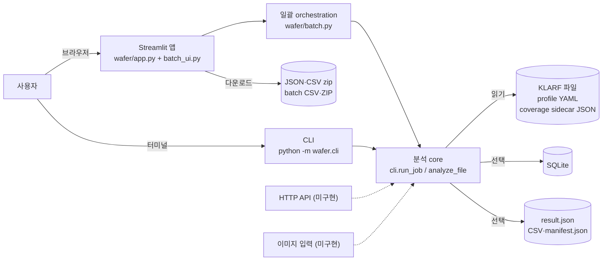
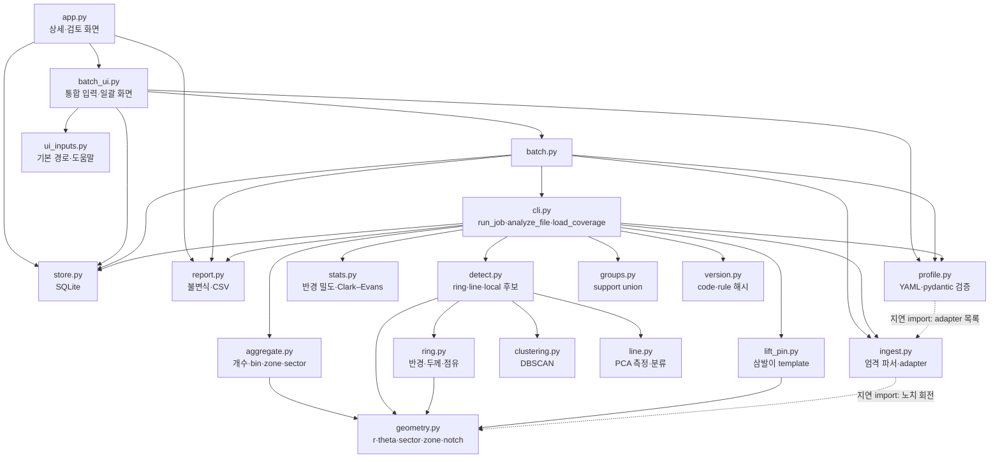
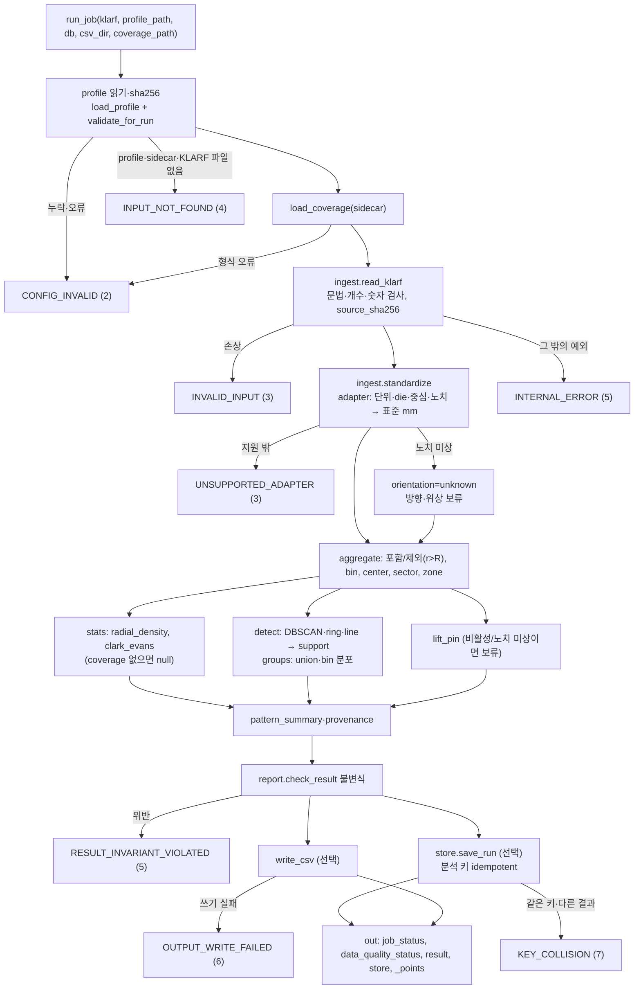
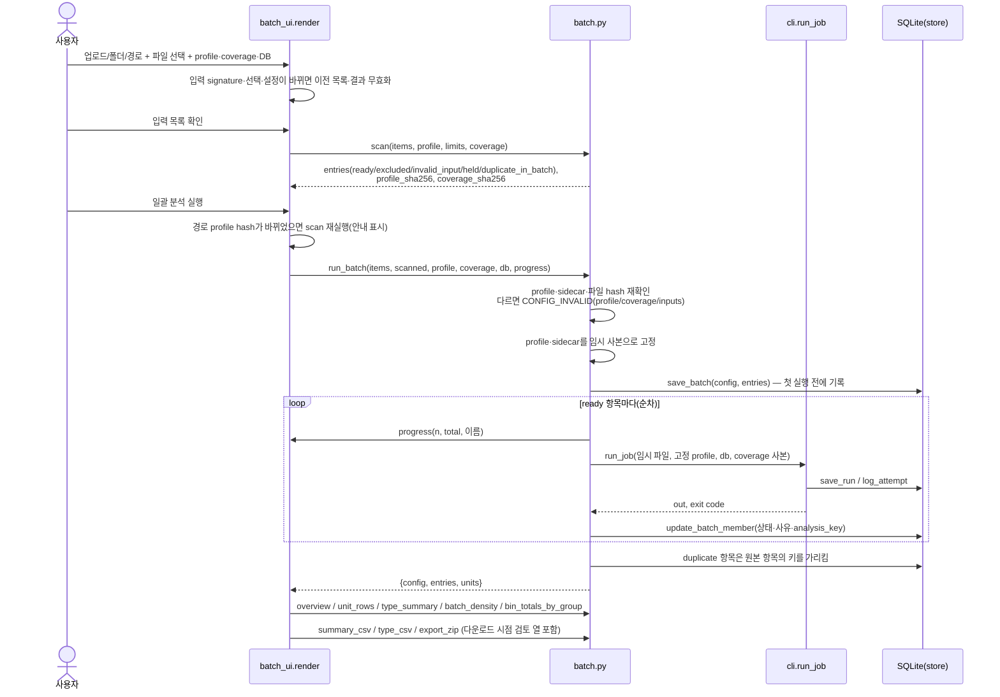
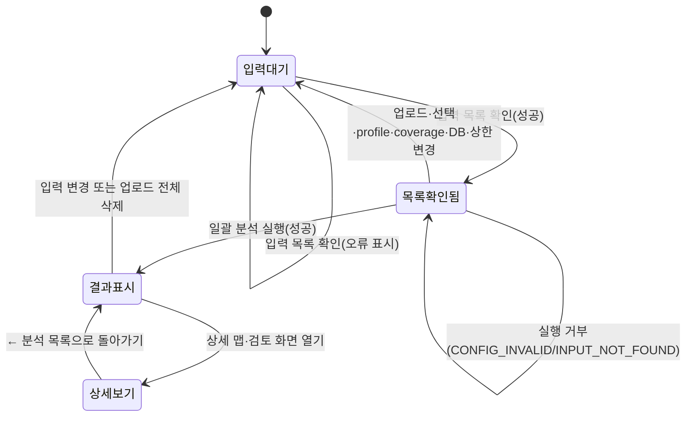

# 4. 아키텍처 다이어그램

- 기준: `wafer/` 코드의 실제 import·호출 관계(2026-10-11). 계획 단계 구조(이미지 경로, API, 배포)는 실행계획 3·13절이며, 아래 그림에는 **구현된 것만** 그리고 미구현은 점선·주석으로 구분한다.
- 원칙: 분석 core는 하나(`wafer.cli.run_job` → `analyze_file`)이고 CLI·화면·일괄 분석이 모두 이것을 호출한다. 화면에는 분석 로직이 없다.

## 1. 시스템 구성(실행 환경)

- 화면은 core를 직접 부르지 않고 `batch.py`를 거쳐 `run_job`을 호출한다(파일 1개도 같다).
- SQLite 쓰기 주체: `run_job` → `runs`·`attempts`, `batch.py` → `batches`·`batch_members`, 상세 화면(`app.py`) → `reviews`. 모두 `store.py` 함수를 쓴다.
- 단일 프로세스·로컬 실행이다. queue·worker·외부 DB·인증은 없다.
- 업로드 파일은 서버 메모리에서 읽고 위치 번호 이름의 임시 파일에만 쓴 뒤 지운다. 업로드 이름을 경로로 쓰지 않는다. "또는 KLARF 경로" 입력은 **서버**의 파일을 읽는다.

## 2. 모듈 의존 관계

점선은 함수 안의 지연 import다. 이 그림은 `wafer/*.py`의 import를 손으로 옮긴 것이므로 import를 바꾸면 함께 고친다.

| 계층 | 모듈 | 책임 |
|---|---|---|
| 화면 | `app.py`, `batch_ui.py`, `ui_inputs.py` | 입력 수집, 세션 상태, 표·그림·다운로드. 계산하지 않음 |
| orchestration | `batch.py` | 입력 목록(scan), 입력 고정, 순차 실행, 단위 지표·요약·export |
| core 진입 | `cli.py` | 오류→종료 코드 매핑, coverage 로드, 분석 흐름, 저장 호출 |
| 입력 | `ingest.py`, `profile.py` | KLARF 엄격 파싱·adapter 변환, profile 검증 |
| 계산 | `geometry`, `aggregate`, `stats`, `clustering`, `ring`, `line`, `detect`, `groups`, `lift_pin` | 좌표·집계·통계·후보·측정 |
| 출력·저장 | `report.py`, `store.py`, `version.py` | 불변식 검사·CSV, SQLite, 버전 해시 |

`version.code_version()`은 `app.py`를 뺀 `wafer/*.py` 전체(화면 모듈 `batch_ui.py`·`ui_inputs.py` 포함)의 내용 해시다. 이 모듈들을 수정하면 분석 키가 바뀐다(T-28).

## 3. 단일 분석 흐름(`run_job`)

- 무작위성 검정 결과와 무관하게 후보 검출을 실행한다(검정은 gate가 아님).
- 실패한 job은 결과로 저장하지 않고 `attempts`에 `failed`로만 남긴다.
- `_points`(결함별 표준 좌표)와 `_wafer_radius_mm`는 화면·export용 내부 값이며 CLI JSON에서는 지운다.

## 4. 일괄 분석 시퀀스

## 5. 화면 상태 전이

세션 키(테스트에서도 사용): `batch_scan`(목록), `batch`(결과), `batch_items`, `batch_selected`, `batch_input_context`, `batch_upload_signature`, `batch_upload_epoch`, `job`(상세 대상), `show_detail`.

## 6. 산출물

| 산출물 | 생성 위치 | 내용 |
|---|---|---|
| `result.json` | CLI `--out`, 상세 화면 JSON 다운로드 | `job_status`·`data_quality_status`·`result`·`store`(화면 다운로드는 `review` 추가) |
| `defects.csv`, `spatial_counts.csv`, `bin_sector.csv`, `manifest.json` | `report.write_csv` | 결함별 행, 공간 집계, bin×sector, provenance·null 규약 |
| `batch_summary.csv`, `batch_type_summary.csv` | `batch.summary_csv`, `type_csv` | 단위별 행, 유형별 요약 |
| `batch_results.zip` | `batch.export_zip` | `batch_manifest.json`, 두 요약 CSV, `units/NNNN_이름/`(result.json·CSV·manifest) |
| SQLite | `store.py` | [5_ERD.md](5_ERD.md) |

## 7. 계획 대비 미구현 구성

| 계획 구성(실행계획 3·13절) | 현재 |
|---|---|
| 이미지 → 위치 추정 경로 | 없음(E15 N/A) |
| HTTP API(FastAPI) | 없음. 사내 HTTP 연동 요구 시 추가 |
| queue·worker·동시 job 상태(`queued`/`running`) | 없음(순차 실행) |
| container·CI·staging·rollback | 없음(Phase 4) |
| 과거 분석·batch 조회 화면 | 없음(FR-ST-03) |
| ML 모델·model_version | 없음(`model_version: null`) |
