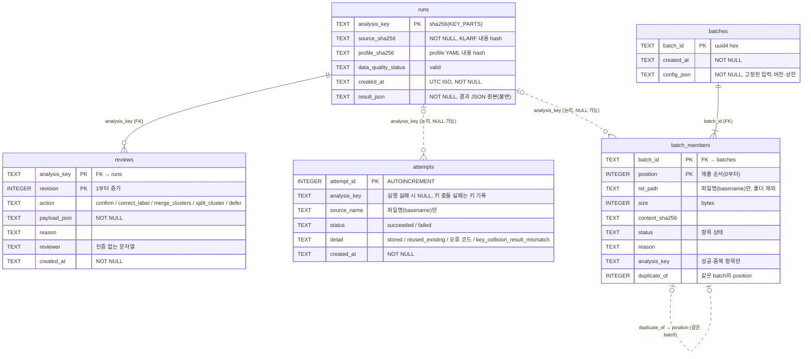
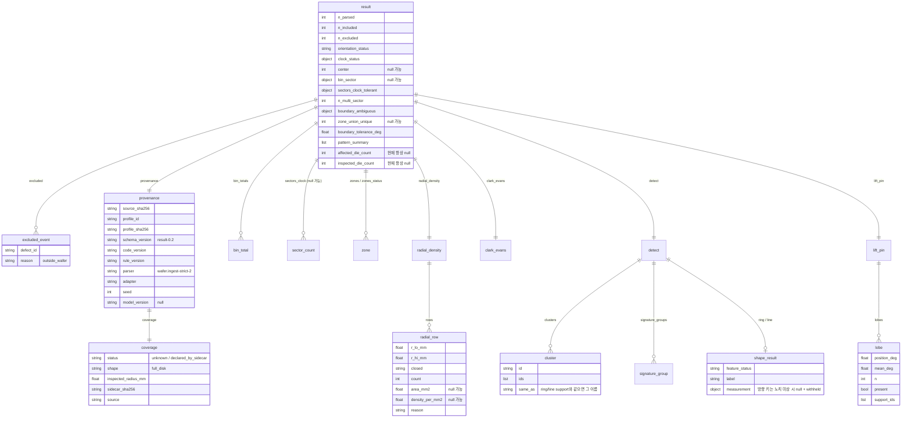

# 5. ERD (데이터 모델)

- 기준: `wafer/store.py`의 `SCHEMA`(SQLite)와 `wafer/report.py`의 `RESULT_KEYS`(결과 JSON), `wafer/batch.py`(batch config·manifest). 2026-10-11.
- SQLite는 선택 기능이다(CLI `--db`, 화면 "SQLite 저장 경로"). 경로를 비우면 저장·검토·재사용 없이 분석과 다운로드만 된다.
- schema migration은 없다. `CREATE TABLE IF NOT EXISTS`로 처음 연결할 때 만든다(T-24).

## 1. SQLite 물리 모델

- 실선 관계는 SQLite 외래 키로 강제된다(`PRAGMA foreign_keys = ON`). 점선은 코드가 지키는 논리 관계이며 DB 제약은 없다.
- `batch_members.rel_path` 열 이름과 달리 폴더를 뺀 파일명만 저장한다. 전체 상대 경로는 DB에 없고 화면(입력 목록·단위 표·상세 caption)과 다운로드(`batch_manifest.json`, 요약 CSV·필터 CSV)에만 있다(T-27 ①).

## 2. 테이블별 규칙

| 테이블 | 쓰기 함수 | 규칙 |
|---|---|---|
| `runs` | `store.save_run` | 분석 키당 1행. 같은 키·같은 결과(JSON 왕복 비교)면 재사용(`created=false`), 다른 결과면 저장하지 않고 `KeyCollision`. **실패 job은 저장하지 않는다.** 행을 수정·삭제하는 코드는 없다 |
| `attempts` | `store.log_attempt`, `save_run` | 제출마다 1행(재시도·재사용·실패 모두). 결과를 중복 저장하지 않으면서 이력을 남긴다 |
| `reviews` | `store.add_review` | append-only. 검증과 revision 번호 부여를 한 `BEGIN IMMEDIATE` 트랜잭션에서 한다. 예측 원본(`runs.result_json`)은 바꾸지 않는다 |
| `batches` | `store.save_batch` | batch마다 1행. 첫 파일 분석 **전**에 기록해 중단돼도 제출 범위가 남는다 |
| `batch_members` | `store.save_batch`, `update_batch_member` | 제출한 모든 항목(제외·실패 포함) 1행씩. 실행 후 상태·사유·키만 갱신. 결과·검토를 복제하지 않고 키로 참조 |

### 2.1 분석 키(`analysis_key`)

`sha256(json.dumps({source_sha256, profile_sha256, schema_version, code_version, rule_version, parser, adapter, seed, coverage{status, shape, inspected_radius_mm, sidecar_sha256}}, sort_keys=True))`

- 파일명·실행 시각은 키에 들어가지 않는다.
- `code_version`은 `app.py`를 뺀 `wafer/*.py` 내용 해시이므로 화면 모듈 수정도 키를 바꾼다(T-28).

### 2.2 상태 값

| 열 | 값 |
|---|---|
| `attempts.status` | `succeeded`, `failed` |
| `batch_members.status` | 저장 시: `ready`, `excluded`, `invalid_input`, `held`, `duplicate_in_batch` → 실행 후: `succeeded`, `failed`, `held` (그 외는 그대로) |
| `review_status`(계산값, 열 아님) | 최신 revision의 action: 없음 `unreviewed`, `confirm` → `confirmed`, `defer` → `deferred`, 그 외 → `corrected` |

### 2.3 `batches.config_json`

| 키 | 의미 |
|---|---|
| `batch_id`, `created_at` | 식별·시각 |
| `profile_id`, `profile_sha256` | 고정된 profile |
| `coverage_sidecar_sha256` | 고정된 sidecar, 없으면 `null` |
| `code_version`, `rule_version` | 실행 시 버전 |
| `adapter`, `wafer_radius_mm` | profile 값 |
| `limits` | `max_files`, `max_file_bytes`, `max_total_bytes` |
| `equipment_signature`, `defect_volume` | 실행 시점 profile 설정 사본(2026-10-12). 없으면 이전 batch → `not_configured` |

## 3. 결과 JSON 논리 모델(`runs.result_json`, `result.json`의 `result`)

- 결과 키 집합은 `RESULT_KEYS`로 고정되며 누락·추가 키는 불변식 위반이다.
- `null_reasons`(result-0.2): 값이 `null`인 최상위 필드 → 사유 문자열. 집합이 null 필드와 정확히 같아야 한다(`check_result`). 예: 기본 F01은 `affected_die_count`·`inspected_die_count`, 노치 미상이면 시계방향 관련 5개 필드가 추가된다. 중첩 null은 각자의 `calc_status`/`feature_status`/`reason`/`withheld`가 사유다.
- 결함별 행(`_points`)은 JSON에 넣지 않고 `defects.csv`로만 내보낸다(T-23).
- 화면 다운로드 JSON은 최상위에 `review: {analysis_key, review_status, latest_revision}`(저장 안 했으면 `null`)를 덧붙인다. CLI JSON에는 없다.

## 4. 일괄 분석 메모리 모델과 다운로드

`run_batch`의 반환값(세션 `batch`)은 DB와 별개로 화면·다운로드에 쓰인다.

| 객체 | 키 |
|---|---|
| `config` | 2.3과 같음 |
| `entries[]` | `index`, `rel_path`(전체 상대 경로), `size`, `sha256`, `status`, `reason`, `parser`(표시용 문법 라벨), `adapter`, `profile_id`, `meta{lot, wafer, job, equipment, step, source}`, `duplicate_of`, `analysis_key`, `reused`, `exit_code` |
| `units{index: out}` | 성공 항목의 `run_job` 출력 |

아래 열 서술은 요약이며 원본은 `batch.unit_rows`·`type_summary`·`export_zip`이다.

| 다운로드 파일 | 행/키 |
|---|---|
| `batch_summary.csv` | 항목 1행(맨 끝 `null_reasons` 열 = 그 행의 None 셀별 사유 JSON): 상태, `candidate_types`(상태 바로 오른쪽; wafer별 코드 뒤에 `equip_*`·`inspection_abort_suspect`·`excess_defect`), 사유·중복·재사용·키, lot/wafer(헤더 값, 미검증), 개수·bin, 유형별 상태·support·비율·사유, 주요 방향·개수·분모·비율, 유효 면적·밀도·사유, ring 반경·직경·두께·극단 폭, line 길이·폭·잔차·방향, 삼발이 lobe JSON, union, `equipment_id`·`step_id`(헤더 값), `equipment_signature_status`·`_reason`·`_detail`(JSON: 유형별 반복 여부·peers·steps 또는 사유), `defect_volume_status`·`_reason`, 검토 상태·최신 revision(DB 지정 시) |
| `batch_type_summary.csv` | 유형 1행: candidate·matched·no_match·insufficient_data·disabled 수, 평가 가능/불가 단위 수, 평가 안 된 파일 수, 고유 support 합, 기준(`initial predictions`) |
| `batch_manifest.json` | `config`, `overview`, `entries`, `type_summary`, `density_by_group`(None이면 `reason`), `bin_totals_by_group`, `scope`, `coverage_note`, `null_convention` |

- `meta.lot/wafer`는 KLARF 헤더(평면 `LotID`/`WaferID`, 1.8 `LotRecord`/`WaferRecord` 이름)에서 읽은 **미검증** 표시값이며 키·중복 판정·집계에 쓰지 않는다(T-26).
- `duplicate_in_batch` 행은 원본 행의 값을 반복하므로 합산은 `status=succeeded` 행만 한다.
- 원본 bin 합계와 밀도는 profile 내용(sha256)·adapter가 같은 그룹 안에서만 합친다.
