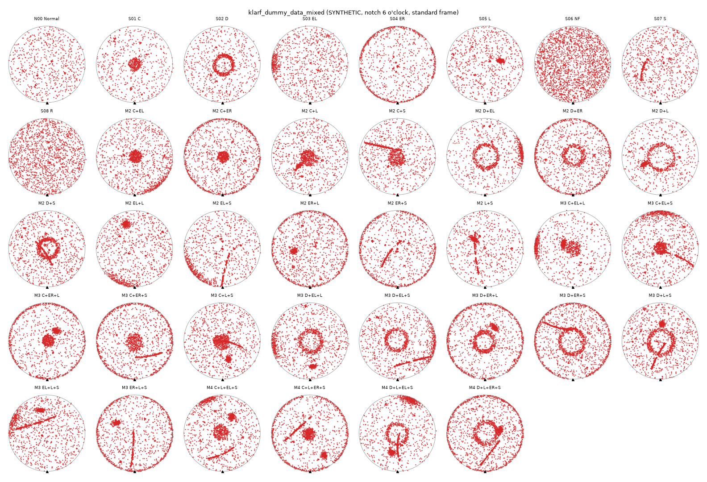

# 지저분한 혼합 패턴 합성 KLARF 묶음 (MixedWM38 스타일, 38종)

**합성 전용.** 실제 장비·lot·검사 자료가 아니며 MixedWM38 데이터 자체도 아니다. MixedWM38(EDS die 단위 fail map)의 **클래스 구성만** 빌려, 인라인 검사처럼 결함 **점(dot)** 으로 배치하고 배경 잡음을 많이 넣었다. 패턴 이름은 생성 의도이며 분류기의 정답·공정 원인이 아니다. 공개 EDS 자료의 성능을 내부 인라인 성능으로 쓰지 않는 원칙(CLAUDE.md 6-10)은 그대로다.

- 생성: `python klarf_dummy_data_mixed/generate_mixed.py` (저장소 루트에서, 표준 라이브러리만, seed 20261012). `--png`로 `maps/overview.png`를 함께 만든다(matplotlib 필요).
- 기대값은 생성기가 **분석 코드(`wafer/`)를 쓰지 않고** 직접 계산한다.
- 파일 규약은 [klarf_dummy_data](../klarf_dummy_data/README.md)와 같다: KLARF 1.8 단일 WaferRecord, adapter `synthetic-die-local-v1`, 노치 DOWN, die pitch 10000 µm, SampleCenterLocation 150000 µm, 300 mm wafer.

## 클래스 구성 (38)

| 구분 | 수 | 파일 |
|---|---:|---|
| 정상(배경 잡음만) | 1 | `N00_normal` |
| 단일 | 8 | `S01_C`(Center) `S02_D`(Donut) `S03_EL`(Edge-Loc) `S04_ER`(Edge-Ring) `S05_L`(Loc) `S06_NF`(Near-full) `S07_S`(Scratch) `S08_R`(Random) |
| 2중 혼합 | 13 | C+EL, C+ER, C+L, C+S, D+EL, D+ER, D+L, D+S, EL+L, EL+S, ER+L, ER+S, L+S (`M2_01`~`M2_13`) |
| 3중 혼합 | 12 | C+EL+L, C+EL+S, C+ER+L, C+ER+S, C+L+S, D+EL+L, D+EL+S, D+ER+L, D+ER+S, D+L+S, EL+L+S, ER+L+S (`M3_01`~`M3_12`) |
| 4중 혼합 | 4 | C+L+EL+S, C+L+ER+S, D+L+EL+S, D+L+ER+S (`M4_01`~`M4_04`) |

결함 수는 파일당 712~2245건, 합계 55,262건이다(포함 55,192 / 웨이퍼 밖 제외 70).



## "지저분함" 구성

| 요소 | 내용 | 기대값에 미치는 영향 |
|---|---|---|
| 배경 잡음 | 모든 파일에 원판 균일 450~800건 | 개수에 포함 |
| nuisance clump | 3~8개의 작은 무작위 뭉침(점 5~15개). 패턴 의도가 아님 | DBSCAN 국부 후보로 보일 수 있음 |
| 패턴 변형 | Center/Loc 중심 이동·불규칙 경계, Donut 두께·밀도 불균일, Edge-Ring 1~3개 끊김, Scratch 곡선·1~3개 끊김·폭 σ 1.1 mm·주변 흩뿌림 | — |
| 웨이퍼 밖 점 | 파일당 0~4건, r ∈ (150.2, 153) mm | `outside_wafer`로 제외, `excluded_ids`에 기록 |
| 같은 위치 다른 이벤트 | 파일당 1~3건 | 별도 이벤트로 세야 함(병합 금지) |
| unknown bin | 약 2%가 CLASSNUMBER 0 | `unknown` bin으로 보존 |
| bin 분포 | 패턴별 주 bin(Center·Loc=1, Donut·Scratch=2, Edge=3) 85% + 나머지 무작위 | 시험 코드이며 사내 bin 의미 아님 |

경계에서 부동소수 반올림으로 정답이 갈릴 수 있는 점(r=150 ±0.01 mm, r=1 mm ±0.001, sector 경계 ±1e-6°)은 생성 단계에서 다시 뽑는다. 좌표는 0.1 µm로 양자화한 값으로 기대값을 계산한다.

## 포함 자료

| 경로 | 내용 |
|---|---|
| `klarf/*.klarf` | 입력 38개 |
| `expected/<name>.json` | 총수·포함·제외(ID)·bin·center·12 sector·생성 그룹별 ID·sha256 |
| `expected/<name>.csv` | 결함별 표준 좌표(mm)·반경·bin·생성 그룹·포함 여부·시계방향 |
| `manifest.json` | 목록, 수량, 해시, 사용할 profile·sidecar |
| `maps/overview.png` | 노치 6시 기준 전체 미리보기 |

생성 그룹(`background`, `nuisance_clump`, 패턴 코드, `outside`, `duplicate_position(...)`)은 expected에만 있고 KLARF에는 넣지 않았다(`CLUSTERNUMBER=0`).

## 사용

화면: **또는 KLARF 경로** 대신 **폴더 선택**에 `klarf_dummy_data_mixed/klarf`를 올리고, profile은 기본값(`tests/profiles/dummy_die_local_test_profile.yaml`), coverage는 `klarf_dummy_data/synthetic_profile.json`(합성 선언)을 쓴다.

CLI 예:

```bash
python -m wafer.cli klarf_dummy_data_mixed/klarf/M4_03_D+L+EL+S.klarf --profile tests/profiles/dummy_die_local_test_profile.yaml --coverage klarf_dummy_data/synthetic_profile.json
```

시험: `python -m pytest tests/test_dummy_mixed.py -q`(개수·bin·center·sector·제외 ID·결정론 대조, 형상 라벨은 검사하지 않음).

## 관찰 기록 (2026-10-12, 형상 판정 정답이 아님)

현재 시험 profile(임계값은 시험 전용, `calibrated: false`)로 38개를 분석한 결과다. **개수·bin·center·sector는 38/38 기대값과 일치**했다. 형상 후보는 다음과 같았다.

| 항목 | 결과 | 해석 |
|---|---|---|
| ring 후보 | 38/38 `candidate`(Normal·Random 포함) | ring 검출기는 중심 기준 가장 밀집한 반경 하나를 항상 고른다. 잡음이 많으면 분류 임계값만으로 걸러지지 않음(T-14, T-19) |
| line 후보 | Scratch 포함 18개 중 8개 `candidate`, Scratch 없는 20개 중 7개 `candidate`(Normal 포함) | 곡선·끊긴·폭 넓은 scratch는 직선 inlier 1 mm 기준에서 놓치고, 고밀도 잡음에서는 우연한 직선이 잡힘(T-18, T-19) |
| local_cluster | 38/38 | 배경 잡음·nuisance clump가 DBSCAN(eps 10 mm, min 3) 군집을 만든다 |

이 결과는 오경보·미탐 **관찰**이며 확정 성능 지표가 아니다. 임계값을 이 자료에 맞춰 바꾸지 않았다. 확률·성능을 말하려면 정답 라벨과 보정 자료가 필요하다(docs/9_TBD.md T-14·T-18·T-19).
