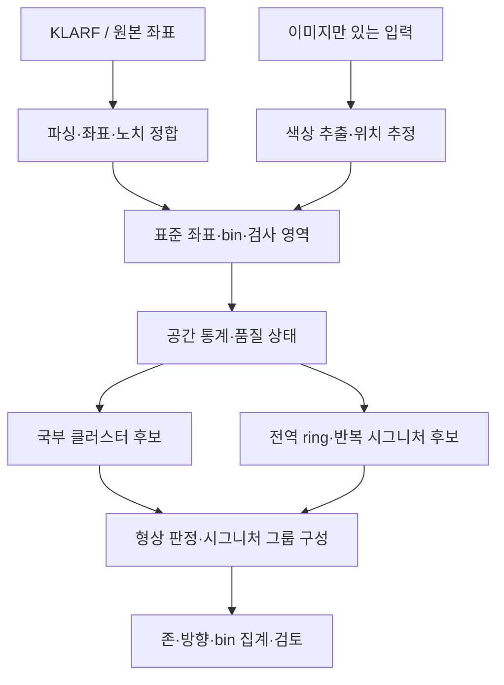

# 인라인 검사 Wafer Map 자동 분석 실행계획

작성일: 2026년 10월 9일  
문서 버전: 1.1 · 완료 체크리스트, 일관성 검증표, E2E 시험 명세 추가  
설계 상태: 구현 착수용 초안. 실제 KLARF, 사내 유형 정의 및 검증 라벨은 아직 확인하지 않음.  
입력 근거: 기존 `wafer_inspection_map_knowledge.md`의 현행 내용, 추가 제공 지식, 본 문서 말미의 재확인 문헌.

## 1. 목표와 1차 구현 범위

KLARF 결함 좌표를 입력받아 노치 6시 기준으로 정렬하고, 결함의 공간 패턴과 위치를 분석한다. 웨이퍼 전체 요약과 함께 클러스터별 유형·존·시계방향·classification bin별 건수를 제공한다. 여러 클러스터가 하나의 설비 시그니처를 이루는 경우 별도의 시그니처 그룹으로 묶는다.

첫 구현은 규칙 기반 MVP로 구성한다. 이미지 입력은 원본 좌표가 없는 경우의 제한된 보조 경로로 제공하고, KLARF 경로에서 이미지를 다시 읽어 좌표를 재추출하지 않는다. Tensor 생성은 시각화·밀도 분석·후속 CNN의 선택 모듈로 둔다.

| 범위 | 포함 내용 |
|---|---|
| MVP 필수 | KLARF 파싱, 좌표·단위 정합, 노치 정규화, bin 집계, 기본 형상, 클러스터, 시계방향 리포트, 검토 결과 저장 |
| 설정 확보 후 MVP 활성화 | E1/E2 존, 반경 100mm의 내부·경계 존, 삼발이 템플릿 |
| 다음 확장 | Reticle repeater, 그리퍼 위치 템플릿, ML 및 CNN 비교 |
| 별도 검증이 필요한 기능 | 물리적 원인 확정, 설비 자동 제어, 전기적 fail·수율 예측 |

SSA는 결함 군집과 시그니처 분류, 사용자 사례 학습이라는 점에서 본 시스템의 직접적인 출발점이다 [S1]. EDS 기반 WM811K·MixedWM38은 형상 표현의 비교 실험에 활용하되, 인라인 검사 성능을 입증하는 자료로 간주하지 않는다 [S8].

## 2. 추가 설명에서 확정하거나 보완할 설계 사항

| 항목 | 실행계획의 결정 | 이유 |
|---|---|---|
| Phase 1 이미지→tensor | KLARF→표준 좌표를 주 경로로 변경 | 원본 위치·개수·bin 보존 |
| 클러스터별 판정 | 클러스터와 시그니처 그룹을 별도 관리 | 삼발이는 세 군집, 끊긴 ring은 여러 조각일 수 있음 |
| 무작위성 검정 | 우선 계산하되 초기에는 분석 중단 조건으로 사용하지 않음 | 전체 검정이 작은 국부 패턴을 놓칠 수 있음 |
| Clark–Evans | 관측창을 반영한 검정의 한 특징으로 사용 | 단일 지수로 모든 형상을 구분할 수 없음 |
| 삼발이 k=3 | 후보 점수로만 사용하고 세 위치·반경·위상을 검증 | 하나의 좁은 blob도 k=3 값이 클 수 있음 |
| E1/E2·8인치 | 형상 label과 독립적인 zone label | E1 안에서도 선형·환형·몰림성이 가능 |
| Near-Full | 광범위 결함 분포와 affected die 비율로 재정의 | Inspection defect가 전기적 fail을 의미하지 않음 |
| 회전·반전 | 원본 좌표·노치 좌표·선택적 장비 좌표를 구분 | 원인 설비의 위상과 검사 화면 방향이 다를 수 있음 |
| 공개 데이터 사전학습 | 내부 데이터 단독 학습과 비교하는 선택 실험 | 계측 단위와 데이터 분포가 달라 개선을 보장하지 않음 |

‘3개가 항상 동시에 발생’은 제시된 특허의 특정 pin mark 사례로 취급한다 [S5]. 실제 입력에서 2개만 검출되는 경우도 데이터 누락·부분 검사·약한 신호 등의 이유로 가능하다. MVP는 3개 충족 시 `threefold_match`, 2개는 `partial_match` 후보로 구분하고 동일한 확정 label을 부여하지 않는다.

## 3. 권장 처리 구조



검정 단계의 결과가 ‘유의하지 않음’이어도 E·F를 실행한다. 처리량 최적화를 위해 일부 경로를 생략하는 정책은 독립 검증에서 누락 위험을 측정한 뒤 도입한다. 기본 통계는 전체 점과 bin별 점에 대해 각각 계산한다. Bin별 분석이 데이터 부족이면 부족 상태를 반환한다.

DBSCAN의 noise point는 삭제하지 않는다. Scratch·희박한 ring·repeater 후보가 noise에 포함될 수 있으므로 다른 검출기가 원본 점을 다시 사용할 수 있어야 한다. Ring과 local blob이 겹칠 때 한 알고리즘이 점을 먼저 소비하여 다른 검출을 막는 구조도 피한다.

## 4. 단계별 일정과 완료 조건

아래 8주는 ‘개발 담당 1명, 정기적인 도메인 검토, 데이터·배포 환경 확보’를 가정한 계획 추정치다. 모델 성능이나 완료일 보장이 아니다. 초기 대상은 한 검사 export 계열·한 제품/step 조합으로 제한한다. 입력 변형이 늘어나면 Phase 0·1을 해당 범위에 대해 반복한다.

| 단계 | 예상 시점 | 핵심 작업 | 산출물 | 다음 단계 진입 조건 |
|---|---|---|---|---|
| Phase 0. 입력·정의 확정 | 1주차 | KLARF 필드·단위·방향·bin·coverage 조사, 라벨 가이드, 정답 검증 자료 지정 | 데이터 계약, 좌표 adapter 명세, 설정 항목표, gold manifest | 좌표 기준과 개수 기준을 실제 샘플로 설명 가능 |
| Phase 1. 파싱·정규화 | 2주차 | parser 비교, 원본 보존, 표준 좌표, 노치 6시, overlay, coverage 변환 | ingest/geometry, defect table, QC 리포트 | gold 자료의 좌표·bin·개수 보존 검증 통과 |
| Phase 2. 특징·후보 검출 | 3주차 | 반경·각도·밀도, 무작위성 검정, DBSCAN, 전역 line/ring 후보 | features/clustering, 후보 및 근거 시각화 | 계산 검증과 대표 형상·반례 시험 통과 |
| Phase 3. 규칙 MVP | 4~5주차 | 기본 유형, 존, 삼발이 그룹, 혼합형·보류, 검토 UI, 라벨 저장 | 규칙 engine, JSON/CSV/화면, 검증 보고서 | 분리된 실제 검증셋에서 합의한 지표 충족 |
| Phase 4A. 패키징·스테이징 | 6주차 | CLI·UI, 필요한 경우 API, container, CI 회귀검증 | 배포 후보, 운영 설명서, rollback 절차 | 운영과 같은 환경에서 입력·분석·조회 전 과정 통과 |
| Phase 4B. 현장 병행 검증 | 7~8주차 | 기존 판정과 비교, 미탐·오경보·보류율, 처리량 측정 | pilot 결과, 규칙 수정 이력, 운영 버전 | 사전 합의 기준 충족 및 미해결 오류 처리 방안 확정 |
| ML 확장 | MVP 이후 별도 | 내부 label 학습, RF/XGBoost, 필요 시 CNN·사전학습 비교 | 동일 blind set의 비교표·model card | 규칙 모델 대비 실질적 개선 확인 후 적용 |

배포 패키지는 6주차에 만들고 7~8주차는 병행 평가에 사용한다. 라벨이 적은 특화 유형은 우선 후보 표시·검토 방식으로 제공한다. 필수 기준에 미달하면 해당 유형만 보류 상태로 유지할 수 있으며, 이를 전체 기능의 검증 완료로 표현하지 않는다.

## 5. Phase 0: 실제 데이터로 확정할 항목

### 5.1 수집 묶음

| 자료 | 초기 수집 제안 | 확인할 내용 |
|---|---|---|
| KLARF와 동일 검사의 화면 | export 계열마다 정상·빈 결과·고밀도·혼합·방향 변형 포함, 대략 10~20쌍부터 | 문법, 단위, 좌표·count 일치 |
| 유형 검토 자료 | 확보 가능한 각 유형의 전형·경계·반례, 복수 lot | label 일관성, 규칙 실패 유형 |
| Bin 정의 | 실제 CLASSNUMBER 등 필드명과 사내 매핑 | ADC·review class·다른 bin 필드의 의미 |
| 검사 영역 | scan ROI·제외부·sampling·검사 die 목록 | 면적과 affected die 비율의 분모 |
| 존 정의 | E1/E2의 edge 거리 또는 반경, 100mm 내부·경계의 사용 목적 | 중첩 허용, 경계 포함 규칙 |
| 삼발이 템플릿 | 반경·각도·허용오차·적용 공정/설비·좌표 기준 | 세 점 검출과 시그니처 매칭 |
| 배포 환경 | OS·Python·container 사용·반입 방식·파일 도착량 | 의존성·처리량·UI/API 선택 |

초기 수량은 parser·규칙 개발의 시작값이다. 유형별 재현율을 신뢰성 있게 추정하는 데 충분한 검증 수량이라는 뜻은 아니다. 검증셋 규모는 요구 재현율의 신뢰구간과 허용 오경보를 기준으로 정한다.

### 5.2 판정 단위를 네 층으로 분리

1. `defect`: 원본 개별 이벤트. Bin과 좌표의 기준 단위.
2. `cluster`: 공간적으로 인접한 점 집합. 위치·연장도·밀도를 계산.
3. `signature_group`: 여러 cluster 또는 후보 점을 연결한 ring·삼발이·repeater 등.
4. `wafer_summary`: 위 결과를 합친 다중 label 요약과 총수.

추가 label 축은 `morphology`, `zone`, `signature_match`, `review_status`로 둔다. 예를 들어 형태는 `local_cluster`, 위치는 `E1`, 시그니처는 `gripper_candidate`일 수 있다. 라벨의 의미가 다른 항목을 하나의 상호배타 class 목록에 섞지 않는다.

### 5.3 실제 사내 데이터 도입 시 입력 계약 재검증

현재 구현은 **합성 입력 규약에서만 검증**됐다(`tests/fixtures/klarf`, `klarf_dummy_data`). 이는 사내 입력 지원 완료가 아니다. 실제 샘플이 들어오면 아래 다섯 영역을 export 계열별로 다시 확인하고, 확인된 차이만 Phase 1 수정 작업(P1-07)으로 반영한다. 실제 샘플·명세 없이 파싱 규칙이나 코드를 추측해 바꾸지 않는다. 추적 항목은 TBD.md T-29다.

**현재 합성 가정(2026-10-09 코드 기준)**

| 영역 | 현재 구현의 가정 | 실제 데이터에서 확인할 것 |
|---|---|---|
| 파일명 | 파싱하지 않는다. 파일명은 시도 기록(attempts)에 basename으로만 남고, 분석 키·중복 판정은 파일 내용 sha256을 쓴다 | 아래 ① |
| 내부 형식 | (a) 1.2 스타일 평면 문법(`DefectRecordSpec`/`DefectList`), (b) KLARF 1.8 Record/Field/List, 단일 FileRecord>LotRecord>WaferRecord와 단일 DefectList. 둘 다 UTF-8. 선언 개수·괄호·EndOfFile·중복 Field를 엄격 검사 | 아래 ② |
| 메타데이터 | 단일 분석 결과에는 lot/wafer/job/시간을 출력하지 않는다. 결과의 식별은 source_sha256과 이벤트 키 `레코드순서:DEFECTID`. (2026-10-10) 일괄 분석은 KLARF 헤더의 lot/wafer(평면 LotID/WaferID, 1.8 LotRecord/WaferRecord 이름)를 "미검증" 출처로 입력 목록·요약 CSV·batch manifest에 표시·내보내지만 분석 키·중복 판정·집계에는 쓰지 않는다 | 아래 ③ |
| 좌표 | 합성 adapter 2종을 profile `coordinates.adapter_id`로 명시 선택: `synthetic-um-die00-notch-down`(XREL/YREL=중심 기준 µm, 단일 die), `synthetic-die-local-v1`(raw=(index×pitch+rel−center)/1000, 노치 회전 1회, side는 profile 선언) | 아래 ④ |
| bin | `CLASSNUMBER`만 사용(0=unknown). 표기는 adapter별로 "B<n>" 또는 "<n>". ROUGH/FINE bin은 읽지만 쓰지 않는다 | 아래 ④ |

**① 파일명 규칙.** `date_time_lotid_waferid_jobid` 같은 형식은 예시일 뿐 사내 확정 규칙이 아니다. 실제 필드 순서, 구분자, 날짜·시간 형식과 timezone, 확장자, 선택 필드, 누락값 표기, 필드 값 안에 구분자가 들어가는 경우를 export 계열별로 확인한다. 파일명 규칙은 장비/export별 명시 profile로 두고, 규칙에 맞지 않는 이름은 추측하지 않고 상태(예: 파일명 메타데이터 미상)로 남긴다.

**② 내부 파일 형식.** KLARF 버전, record/list 계층, column 이름·순서·자료형, 추가/누락 field, 복수 wafer·inspection record, 인코딩, 빈 결과와 손상·작성 중 파일의 구분을 확인한다. 지원 범위 밖의 입력은 명시적으로 실패하거나 보류하며, 정상 0건으로 반환하지 않는다(현재 엄격 파서의 원칙 유지).

**③ 메타데이터 정합성.** 파일명과 내부 record에서 얻은 lotid/waferid/jobid/시간이 다를 때의 우선순위와 충돌 처리 정책을 확정한다. 두 값을 출처와 함께 모두 보존하고, 조용히 덮어쓰지 않는다. 파일명만으로 고유 검사 이벤트나 분석 키를 확정하지 않는다(분석 키는 내용 해시와 적용 버전 기준, 16.4).

**④ 좌표와 bin 의미.** 단위, die index/pitch, 상대좌표, 중심, 축, notch, front/back side, classification/rough/fine bin의 의미를 실제 기준점과 장비 명세에 대조한다. 내부 문법이 파싱됐다는 사실과 물리 좌표가 검증됐다는 사실을 별도 상태로 기록한다.

**⑤ 영향받는 기능.** 규칙 변경이 자동 수집(파일 도착·작성 완료 판정), 파서, adapter, 분석 키/중복 방지, 저장·재조회, JSON/CSV export, UI, 테스트에 미치는 영향을 변경마다 확인한다.

**설계 원칙.** 장비/export별 명시적 parser·adapter·파일명 profile을 우선한다. 확정되지 않은 형식을 자동 추측하는 범용 파서나 plugin framework는 만들지 않는다. 필요한 차이는 실제 샘플과 요구가 확인된 뒤 최소 범위로 반영하고, 기존 adapter와 입력 형식이 같으면 새 adapter를 추가하지 않는다.

**테스트 최신성.** 실제 샘플 도입 후 기존 테스트·시나리오의 최신성을 점검하고, 승인된 입력 계약 변경에 해당하는 시나리오만 근거와 함께 개정한다(기존/신규 기대값, 사유, 샘플 manifest 버전 기록). 실패를 숨기려고 기대값을 바꾸지 않는다. 합성 fixture의 기대값은 합성 계약의 정답으로 유지한다.

**완료 기준(P0-07, P1-07 공통).** ① 대상 장비/export 계열별 입력 계약을 문서화했다. ② 검토된 실제 샘플에서 파일명과 내부 메타데이터를 정확히 추출했다. ③ 충돌·누락·미지원 입력을 합의된 상태로 처리했다. ④ 좌표·bin·개수 보존을 독립 정답과 대조했다. ⑤ 영향받는 회귀와 입력부터 출력까지의 실제 흐름을 검증했다. 실제 샘플·정의가 없으면 미완료 또는 BLOCKED로 유지하며, 합성 테스트 통과로 완료 처리하지 않는다.

## 6. Phase 1: KLARF 파싱과 좌표계

### 6.1 파서 선정

`klarfio`는 v1.2·v1.8용 순수 Python 파서로 소개되어 있고 GPLv3로 배포된다 [S2]. `klarfrs`는 Rust 기반이며 같은 버전 지원과 MIT 라이선스를 명시한다 [S3]. 지원 버전 표기가 사내 export 변형의 파싱 성공을 보장하지는 않는다.

먼저 사내 환경에서 설치 가능한 후보를 선택하고 실제 샘플의 header·defect list·가변 column·빈 list·복수 record를 비교한다. 사내 패키지 반입 기준과 라이선스를 함께 확인한다. 성능 우위는 파일 크기별로 측정하며, Rust라는 이유만으로 확정하지 않는다. 분석 코어는 parser 객체에 직접 의존하지 않고 표준 테이블을 받도록 한다.

단순 공백 split로 KLARF 전체를 읽는 parser는 MVP의 기본 경로로 사용하지 않는다. 인용부호·계층 record·버전별 문법·column 순서가 달라질 수 있다. 읽지 못한 필드는 원본과 함께 보존하고 필수 필드 누락은 명시적으로 실패 처리한다.

### 6.2 좌표 변환의 계약

표준 좌표는 wafer 중심 (0,0), 단위 mm, 오른쪽 +X, 위쪽 +Y, 노치 6시로 정의한다. 원본 좌표와 변환 행렬, 사용한 adapter 버전도 보존한다.

개념적인 식은 다음과 같다. 사내 KLARF용 확정 공식은 Phase 0에서 검증한다.

```text
p_device = die_origin(index, pitch, origin_metadata) + local_offset(XREL, YREL)
p_center = p_device - wafer_center_in_same_frame
p_standard = rotate_notch_to_down(axis_and_side_transform(p_center))
```

`XINDEX × DiePitch + XREL − SampleCenterLocation`을 장비 공통 식으로 바로 고정하지 않는다. Index 기준, die 기준점, local offset의 방향, field별 단위, 이미 정규화된 export인지 확인한다. 일부 field만 μm에서 mm로 바꿔 scale이 섞이는 오류도 검증한다.

Nanotronics 문서는 OrientationMarkLocation과 중심까지의 벡터를 설명하지만 한 공급업체의 export 안내다 [S4]. 다른 장비의 SampleCenterLocation·DieOrigin 해석까지 공통으로 검증한 문서로 취급하지 않는다.

### 6.3 방향 검증

노치 위치만으로 좌우반전은 결정할 수 없다. Front/back 표시 관례, 축 방향, export가 이미 노치 아래로 회전됐는지 등을 adapter에서 확정한다. 점·검사 영역·die geometry·reticle origin을 같은 변환으로 정합한다.

표준 좌표에서 각도는 다음과 같이 계산한다.

```text
r_mm = sqrt(x_mm**2 + y_mm**2)
rho = r_mm / wafer_radius_mm
theta_clock_deg = degrees(atan2(x_mm, y_mm)) % 360
```

0°=12시, 90°=3시, 180°=6시, 270°=9시다. 중심과 그 주변의 각도 불안정 영역은 `center`로 별도 집계한다. 적용 제외 반경은 위치 오차를 고려해 설정한다. 12개 sector는 각 시각 중심 ±15°로 정의하며, 345°~15°는 12시 구간이다. 보고서에 사용하는 구간의 시작·끝 각도도 저장한다.

### 6.4 반드시 보존할 값

`inspection_id`, `source_file_hash`, `source_record_id`, `defect_id`, 원본 좌표, 표준 좌표, 원본 bin, 매핑한 bin, 검사 조건, side, 단위, orientation 상태를 보존한다. 식별자는 inspection 내에서만 유일할 수 있다. 같은 좌표에 여러 이벤트가 있다고 자동 중복 삭제하지 않는다.

개수는 `파싱된 레코드 = 분석 포함 + 명시적 제외`로 일치해야 한다. 영역 밖 점은 원점이나 edge로 이동시키지 않고 제외 사유를 기록한다. 미분류 bin도 unknown bin으로 보존한다. Coverage가 없으면 전체 원판을 검사했다고 가정하지 않고 밀도·유의성 일부를 계산 불가로 둔다.

### 6.5 이미지 보조 경로

HSV의 두 빨강 범위와 connected components를 사용하되 H 범위는 일반 OpenCV uint8 기준 0~179이다. 제공된 0~10, 170~180은 시작 후보로만 두고 170~179 등 실제 표현 범위와 S·V 임계값을 검증한다. Dot 겹침·JPEG·색상 변화 때문에 원본 defect 개수를 보장하지 않는다.

이미지 입력의 결과에는 `source=image`, `count_quality=estimated`를 표시한다. Bin이 색상이나 별도 map에 연결되지 않으면 bin별 방향 결과를 생성하지 않는다. 물리 크기·방향이 검증되지 않은 이미지에서 E1/E2의 mm 기준 또는 삼발이의 물리 반경 판정을 실행하지 않는다.

## 7. Phase 2: 공간 특징과 후보 생성

### 7.1 통계 계산

반경은 mm와 정규화 r/R를 모두 보존한다. `edge_distance_mm = wafer_radius_mm − r_mm`로 외곽 존을 표현한다. Ring 밀도의 분모는 해당 원환과 실제 검사 영역의 교집합 면적이다. 같은 폭의 ring이라도 면적이 다르므로 건수만 비교하지 않는다.

각도는 시계방향 12개 sector로 보고하되, 좁은 시그니처 탐색은 더 세밀한 각도 격자 또는 원본 각도로 수행한다. 고정 sector 경계에 걸친 몰림은 원형 이동창으로 보완한다. 11시와 1시를 산술평균하여 6시로 표시하지 않는다.

각도 CV는 건수·coverage에 영향을 받는다. 원시 count CV만으로 ring 또는 편중을 확정하지 않는다. 검사 영역별 기대 건수에 대한 편차와 원형 집중도, 각도 점유 범위를 함께 계산한다. Full ring이나 서로 반대편의 두 군집을 하나의 평균 방향으로 요약하지 않는다.

### 7.2 무작위성 검정

Clark–Evans 지수의 기본형은 관측 평균 최근접거리와 균일 Poisson 가정의 기대거리 1/(2√λ)의 비율이다. 유한 wafer와 부분 검사에서는 관측창 처리가 중요하다 [S7].

MVP는 동일 검사 영역·관측 건수를 조건으로 모의 분포를 생성해 비교하는 방법을 우선 검토한다. 균일 검출 가정이 맞지 않으면 제품·recipe별 정상 참고 분포를 사용한다. 원형 영역에 사각형 전용 경계 보정을 그대로 적용하지 않는다. Sparse map·한 점·coverage 미상은 검정 불가 상태를 반환한다.

‘무작위성을 기각하지 못함’은 무작위라는 증명도, 무결함 판정도 아니다. 검정 결과는 우선순위·근거의 일부로 기록하고 국부 후보 검출을 계속한다. Koo·Hwang 연구의 core point 기반 통계는 Clark–Evans와 동일 알고리즘이 아니다 [S6]. 두 방법을 혼동하여 논문 재현이라고 표시하지 않는다.

### 7.3 후보 검출기

| 후보 | 계산 | 반례 시험 |
|---|---|---|
| Local | 물리 단위 DBSCAN, 필요 시 여러 eps 비교 | 밀도가 다른 두 cluster, 약한 군집 |
| Line | 좌표 RANSAC·PCA, 보조 Hough | 멀리 떨어진 두 blob, reticle 격자 |
| Arc | 제한된 반경 범위의 원 적합·RANSAC, 보조 Hough circle | 짧은 arc, 긴 반경으로 line처럼 보이는 경우 |
| Ring | 반경 밀도 peak·각도 support·중심 offset | 한쪽 blob, 부분 검사, 끊긴 ring |
| 광범위 고밀도 | coverage 보정 밀도·점유 셀/검사 die 분포 | 작은 영역에만 매우 많은 점 |
| 반복 후보 | 각도/반경 템플릿 또는 reticle 상대좌표 | 규칙적인 sampling이 만든 가짜 반복 |

DBSCAN 한 번으로 모든 시그니처를 분리한다고 가정하지 않는다. 후보 간 충돌과 중첩은 Phase 3에서 처리한다. 매우 큰 N에서 전체 거리행렬을 만들지 않고 공간 인덱스와 국부 이웃을 이용한다. 리포트용 downsampling이 필요해도 건수 집계와 원본 보존에는 전체 데이터를 사용한다.

## 8. Phase 3: 규칙과 특화 유형

### 8.1 형상 규칙

각 rule은 label 하나뿐 아니라 근거값·설정 기준·충족 여부·보류 사유를 반환한다. 예를 들어 선형은 길이/폭, 직선 잔차, 지지점 비율, 연속성을 함께 사용한다. 환형은 반경 폭과 각도 coverage를 함께 사용한다. 실제 수치 threshold는 gold 자료의 학습/보정 부분에서 정하고 blind set에는 맞추지 않는다.

출력 상태는 `matched`, `candidate`, `unknown`, `insufficient_data`, `invalid_input`으로 구분한다. `no_clear_pattern`과 `no_detected_defect`도 분리한다. 광범위 분포를 판단하는 affected die 비율은 `defect가 있는 고유 die / 검사한 고유 die`이며 전기적 불량 die 비율로 부르지 않는다.

### 8.2 삼발이

삼발이 규칙은 세 위치의 배열에 대한 시그니처 매칭이다. 세 개의 defect일 수도 있고 세 개의 defect 군집일 수도 있으므로 군집 중심과 군집 내 점을 모두 확인한다.

1. 템플릿의 반경 band에 해당하는 후보를 모은다.
2. 각도별 lobe 또는 국부 cluster 후보를 구한다.
3. 서로 다른 세 위치의 각도 간격이 약 120°인지 확인한다.
4. 각 위치의 반경과 설비 템플릿 위상이 허용오차 안인지 확인한다.
5. 검사 coverage가 세 위치를 포함하는지 확인한다.
6. 세 위치 충족이면 그룹을 만들고, 부분 충족은 별도 후보로 표시한다.

푸리에 보조 특징의 한 예는 다음과 같다. θ는 시계방향 각도이며 여기서는 radian이다.

```text
z_k = sum(w_j * exp(1j * k * theta_j)) / sum(w_j)
A_k = abs(z_k)
phase_3 = angle(z_3) / 3    # 120도 주기로 동등한 위상
```

이 식은 설계 제안이며 특허가 제안한 푸리에 공식이라고 주장하지 않는다. w는 cluster 중심 기준의 동일 가중치를 초기 후보로 사용하고, defect 개수 가중치는 별도 민감도 분석을 한다. 하나의 큰 blob이 점 개수만으로 점수를 지배하지 않도록 한다.

세 점이 120° 간격이면 이상적으로 A3가 크지만, 한 방향에만 몰린 점도 A3가 커질 수 있다. 따라서 A3 임계값 단독 판정을 금지한다. A1·A2, 서로 다른 세 lobe의 존재, 반경 일치, phase 오차, coverage를 결합한다. k=6 등 다른 harmonic이 함께 클 수 있으므로 A3가 모든 harmonic보다 커야 한다는 조건도 두지 않는다.

템플릿 phase의 좌표 기준을 반드시 기록한다. 원인 후보 공정설비의 접촉 위치가 검사장비의 wafer 배치와 어떻게 연결되는지 모르면, 노치 좌표의 3회 대칭 형태까지만 판정하고 특정 설비 원인으로 확정하지 않는다. 문헌의 120° 사례는 형상 근거이며 현장 모든 삼발이의 보편 규격이 아니다 [S5].

### 8.3 E1/E2와 8인치 존

E1/E2는 edge에서 안쪽으로 잰 거리 또는 중심 반경 중 하나로 정의하고, 단위·경계 포함·중첩 정책을 설정한다. 2~3mm 등의 외부 사례를 사내 E1/E2의 고정값으로 사용하지 않는다.

‘8인치 영역’은 요청한 사내 명칭을 유지하되 `zone_radius_mm=100`이라는 실제 정의를 함께 표시한다. 여기서 100mm는 계획의 명시적 기준이며 8×25.4/2=101.6mm로 자동 변환하지 않는다. 내부 영역 `r<100mm`와 경계 band `|r−100mm|≤width/2`를 별도 tag로 관리한다. Band 폭은 미정이며 설정 전에는 해당 규칙을 비활성화한다.

평면 XY map만으로 top bevel·bottom bevel·apex를 구분할 수 없다. Side 또는 edge inspection channel이 확보되기 전에는 반경 존만 출력한다. E1과 100mm 내부처럼 서로 다른 zone 계층의 중첩은 허용할 수 있지만, 합산할 때 고유 defect 수를 사용한다.

### 8.4 후속 유형

Reticle repeater는 wafer 전체 DBSCAN 결과만으로 찾기 어렵다. 별도 경로에서 defect를 reticle instance의 상대좌표로 정합하고, 동일 위치에 나타난 서로 다른 instance 수와 검사된 instance 수를 센다 [S9]. 단순히 XREL/YREL만 사용하면 die repeater와 multi-die reticle repeater를 혼동할 수 있다. Shot map·reticle pitch·origin·die 배열·정합 오차가 확보될 때 활성화한다.

그리퍼는 실제 접촉각·반경 템플릿으로 관리한다. 제공된 45°·135°·270° 사례를 모든 장비의 기본 설정에 넣지 않는다. Reticle 반복이 ‘검사 데이터에서만 가능한 보편적 유형’이라고 단정하지 않고, 여기서는 인라인 좌표에서 검출할 대상 기능으로 정의한다.

### 8.5 중복과 혼합 패턴

시그니처 후보는 겹칠 수 있다. `defect↔signature` 연결 테이블에 support를 저장하고 후보 중첩을 허용한다. 필요 시 주 소속 `primary_signature_id`를 하나 지정하되 모호하면 null로 둔다. Cluster ID와 signature ID는 서로 다른 필드다.

리포트에는 그룹별 support count와 wafer의 unique defect count를 구분한다. 여러 그룹의 support count를 더해 wafer 총수로 쓰지 않는다. 유형별 multi-label은 존재 여부이며, 각 유형의 공간 영역·bin 구성은 별도 객체로 저장한다.

## 9. YAML 설정 계약 초안

다음은 문서용 설정 예시다. null은 미확정 값이다. 활성 기능의 필수 설정 누락은 실행 전 CONFIG_INVALID로 처리한다. 정상 설정에서 입력 데이터만 부족한 경우에는 전체 오류로 바꾸지 않고 가능한 집계와 기능별 보류 상태를 반환한다. 비활성 기능은 disabled로 표시하며 실행 성공으로 집계하지 않는다. 숫자 예시는 운영 threshold가 아니다. 기능 활성화의 사전조건과 데이터 부족 시 동작은 16절을 따른다.

```yaml
schema_version: "1.0"
profile_id: "draft_profile"
units: "mm"
coordinates:
  adapter_id: null
  source_units: null
  target_notch: "DOWN"
  target_x: "RIGHT"
  target_y: "UP"
  side_convention: null
  missing_orientation: "retain_unknown"
coverage:
  source: "required_for_density"
  missing_policy: "counts_only"
clock:
  sector_width_deg: 30
  sector_centers_start_deg: 0
  center_exclusion_radius_mm: null
zones:
  E1:
    enabled: false
    metric: "distance_from_edge_mm"
    interval_mm: null
    interval_closed: "left"
  E2:
    enabled: false
    metric: "distance_from_edge_mm"
    interval_mm: null
    interval_closed: "left"
  zone_8inch_inside:
    enabled: false
    metric: "radius_mm"
    interval_mm: [0, 100]
    interval_closed: "left"
  zone_8inch_boundary:
    enabled: false
    center_radius_mm: 100
    band_width_mm: null
signatures:
  lift_pin:
    enabled: false
    template_id: null
    frame: "notch_down"
    expected_lobes: 3
    spacing_deg: 120
    radius_band_mm: null
    phase_deg: null
    angular_tolerance_deg: null
    radial_tolerance_mm: null
    min_support_per_lobe: null
    harmonic_weighting: "equal_per_lobe"
    partial_match: "candidate_only"
randomness:
  mode: "conditional_monte_carlo"
  null_model_id: null
  seed: 20261009
  nsim: 999
  alpha: null
  block_downstream_on_non_significance: false
clustering:
  eps_mm: null
  min_samples: null
  retain_noise: true
bin_mapping:
  version: null
  unknown_policy: "preserve"
```

위 예시는 YAML 구조를 제시한 것이며, 필수값이 미설정되어 있어 운영 설정으로 바로 실행할 수는 없다.

설정 검증기는 음수 폭, 역전된 구간, wafer보다 큰 존, 의도하지 않은 같은 계층의 존 중첩, 서로 모순되는 side·방향 설정을 검사한다. 제품·step·공정설비별 profile의 적용 우선순위를 명시하고, 실제 적용값과 config hash를 결과에 저장한다. 이미지만 들어온 경우 물리단위·방향 조건을 만족하지 않으면 관련 기능을 자동 보류한다.

## 10. 사용자 화면과 결과 계약

### 10.1 화면 구성

1. 원본 map과 노치 정합 map, 방향 기준·검사 범위·품질 상태.
2. Cluster·signature overlay와 선택한 그룹의 support 점.
3. 패턴별 표: 형태, zone, 시계방향 범위, 반경/edge 거리, unique count, 주요 bin, 근거값.
4. Bin×시계방향 표 및 반경 밀도. 계산 불가 값은 사유와 함께 표시.
5. 검토: 맞음·유형 수정·군집 병합·군집 분리·판정 보류 및 사유 기록.

MVP 리포트는 확정 계산값을 template 문장으로 작성한다. LLM 요약은 선택 확장이다. 예시 문장은 ‘삼발이 템플릿과 일치하는 세 군집이 관찰됨’으로 두고 ‘lift pin이 불량 원인임’으로 자동 바꾸지 않는다.

### 10.1a 일괄 분석 흐름 (2026-10-10 구현, 합성 검증)

업로드(여러 파일·폴더) → 입력 목록(상태·사유·hash·헤더 메타데이터·적용 parser/adapter/profile) → 고정된 입력으로 단일 core 순차 실행 → batch 개요·분석 단위 표·유형별 요약·정도 원시 지표 → 기존 상세/검토 화면 → 요약 CSV·유형 CSV·ZIP. 정도 지표는 원시 값과 분모만 제공하며 0~100 점수나 정상/위험 등급을 만들지 않는다(등급은 사내 보정 자료와 합의된 임계값 필요, TBD T-31). 상세 정의는 README "일괄 분석"과 19.4.

### 10.2 JSON 주요 필드

| 객체 | 주요 항목 |
|---|---|
| provenance | input hash, parser·adapter·config·rule·model version, 분석 시간 |
| geometry | wafer radius, 원본/표준 frame, notch, side, transform, 검증 상태 |
| quality | count 보존, 영역 밖·미분류·누락 필드, coverage 상태 |
| wafer_summary | unique count, bin totals, multi-label, 판정 상태 |
| clusters | cluster_id, defect IDs, 중심·반경·방향·형상 특징 |
| signature_groups | group_id, 구성 cluster IDs, 유형·template·근거·support defect IDs |
| spatial_counts | bin·zone·sector·count·area·density 및 분모 정의 |
| review | 검토 상태, 수정 label·점 집합·버전 |

빈 배열·0·null의 의미를 구분한다. 0은 측정 또는 집계 결과가 0인 경우, null은 입력 부족으로 계산하지 못한 경우다. 전체 합산은 데이터 계약에서 정의한 고유 이벤트 키를 기준으로 한다. 작업 실행 상태와 분석 판정 상태는 별도 필드로 저장한다. 예를 들어 결과 저장은 succeeded여도 입력의 방향 정보가 없으면 방향 판정은 insufficient_data일 수 있다. 상세 계약은 16절을 따른다.

## 11. 검증과 운영 진입 기준

### 11.1 검증 자료 분리

동일 wafer의 반복 검사·재출력·bin별 이미지·증강 자료는 같은 그룹에 둔다. Lot 단위 분리를 기본으로 하고 이후 시간대의 자료를 blind test로 남긴다. 여러 cluster가 한 wafer에서 나왔다는 이유로 cluster를 독립 샘플처럼 train/test에 무작위 분할하지 않는다. 제품·설비를 새로 추가할 때는 해당 범위의 별도 검증을 한다.

Rule threshold도 학습 파라미터와 같은 방식으로 train/calibration에서만 조정한다. 검토자가 수정한 운영 label은 버전 관리 후 다음 학습 후보에 넣고, 기존 blind set 정답을 반복 수정해 성능을 올리는 방식은 피한다. 의견이 갈리는 자료는 adjudication 또는 ambiguous 상태를 사용한다.

### 11.2 필수 회귀 시험

| 영역 | 시험 내용 | 완료 조건 |
|---|---|---|
| Parser | 가변 column·빈 list·복수 record·누락·지원 밖 버전 | 조용한 레코드 소실 없이 성공 또는 명시적 실패 |
| 좌표 | 4방향 notch·front/back·단위·center offset·역변환 | gold 기준점의 허용오차 내 일치 |
| 집계 | bin·sector·zone·그룹 중첩 | 고유 총수 보존, 중복 합산 없음 |
| 형상 | line·arc·ring·local과 혼합·희박·경계 사례 | 기준 라벨 대비 오류 기록 |
| 삼발이 | 이상 3점·1개 blob·2개 lobe·위상 틀림·반경 틀림·partial coverage | A3 단독 오판 및 부분 일치 확정 방지 |
| 통계 | 균일 점·부분 검사·검출 불균일·소표본 | 모의 자료에서 오경보와 검정 불가 처리 확인 |
| 배포 | 재실행·중복 입력·부분 파일·실패 재시도·rollback | 중복 결과·미완성 정상 판정 방지 |

Golden image만으로 좌표·개수 정답을 평가하지 않는다. Golden KLARF, 기대 표준 좌표, coverage, 기대 count JSON과 필요한 이미지 overlay를 함께 둔다. 그림 pixel 동일성은 rendering 변화에 민감하므로 핵심 통계와 기하학적 값의 검증을 우선한다.

### 11.3 지표와 목표 설정

| 지표 | 운영 적용 전 결정 |
|---|---|
| 지원 입력의 레코드 보존 | Gold fixture에서는 설명되지 않는 소실 0건 |
| 좌표 변환 오차 | 사내 export의 분해능·지도 정합 오차로 tolerance 지정 |
| 유형별 재현율·precision | 중요 유형의 미탐 비용에 따라 Phase 0에서 목표 합의 |
| 오경보율 | ‘정상 참고 wafer당 검토가 필요한 오경보’ 등 분모를 먼저 고정 |
| 보류율 | 품질 미달과 미지 유형을 분리하여 측정 |
| 군집/영역 분리 | 점 소속 F1 또는 영역 IoU, 삼발이는 group 검출률 별도 |
| 추론 시간 | p50/p95, 파일 크기·N·동시 요청 수별 측정 |
| 안정성 | 입력 실패·분석 실패·재시도·중복 실행 결과 기록 |

성능 수치가 정해지지 않았으므로 임의의 ‘95% 달성’을 계획의 사실로 넣지 않는다. 요구 기준은 Phase 0 산출물에 수치화하고, Phase 3·4에서 실제 관측값과 신뢰구간을 보고한다. 충분한 시험 수량이 없는 유형은 잠정 검증임을 명시한다.

## 12. ML 확장 조건과 비교 실험

RF 또는 XGBoost는 규칙과 동일한 공간 특징을 입력받는 비교 모델로 시작한다. 적은 데이터에서 반드시 우수하다고 가정하지 않는다. 희귀 class·혼합형·신규 유형을 포함한 내부 라벨로 검증한다. 다중 label은 class별 이진 모델 또는 적절한 다중 출력 구조로 구성한다.

CNN이 필요해지면 KLARF에서 count map과 coverage mask를 만든다. 필요 시 bin 채널을 추가하며, raw count는 별도로 유지한다. 격자로 줄어든 점 수를 개수 집계의 기준으로 사용하지 않는다.

| 실험 | 목적 |
|---|---|
| A. 규칙 모델 | 운영 기준선 |
| B. 내부 특징 기반 ML | 규칙의 경계 사례 개선 여부 |
| C. 내부 데이터만 학습한 CNN | 이미지 표현의 추가 가치 |
| D. 공개 데이터 사전학습 CNN | C 대비 전이학습 이득 또는 성능 저하 확인 |

공개 데이터에 맞추려고 원본 KLARF를 die 단위 이진값으로만 저장하지 않는다. 사전학습용 파생 표현은 만들 수 있으나 원본 좌표·개수·bin은 유지한다. MixedWM38의 class 존재 label만으로 사내 삼발이·E1/E2·100mm 존의 정답을 얻을 수 없다.

형상 분류에만 회전 augmentation을 사용할 경우 방향 정보와 별도 분기를 유지한다. Tensor·coverage·공간 label은 함께 변환해야 한다. 고정 접촉각을 학습하는 시그니처 분기에 무작위 회전·반전을 그대로 적용하지 않는다. 반전은 front/back 및 공정의 방향성을 바꿀 수 있으므로 기본 비활성으로 둔다.

모델이 개선되더라도 좌표 변환·정확한 count·zone 정의는 검증된 결정적 계산으로 유지한다. Calibration을 하지 않은 score는 확률로 표시하지 않는다. 미지 유형과 추출 품질 실패를 다른 상태로 관리한다.

## 13. 패키징·CI/CD·운영

| 모듈 | 책임 |
|---|---|
| ingest | KLARF·CSV adapter, 원본 hash·metadata·record 보존 |
| geometry | 단위·center·notch·side·좌표 변환 |
| coverage | 검사 ROI·die·유효면적 |
| grid | 선택적 count tensor·coverage raster |
| features | 공간 통계·반경·각도·형상 |
| clustering | 후보 cluster 생성·noise 보존 |
| signatures | line/ring 및 여러 cluster의 복합 시그니처 |
| rules | 설정 검증·조건·근거·보류 정책 |
| model | 후속 학습 모델·calibration·추론 |
| report | JSON/CSV/overlay·요약 문장 |
| interface | CLI·UI, 필요 시 API |

내부 분석 core를 먼저 CLI로 실행 가능하게 만들고 초기 사용자 화면은 Streamlit으로 구성한다. 다른 시스템에서 HTTP 호출이 필요할 때 FastAPI를 추가한다. 두 인터페이스가 분석 코드를 복제하지 않고 같은 core를 호출하도록 한다.

파일 기반 운영은 파일 쓰기 완료 확인 후 입력을 받는다. 재시도 결과는 input hash와 적용 버전 조합으로 식별한다. 코드가 바뀐 재분석은 이전 결과를 덮어쓰지 않고 새로운 분석 run으로 저장한다. 모델 없이 규칙만 실행한 경우도 rule/config version을 반드시 남긴다.

CI 제안 순서는 `설정·schema 검증 → 단위/좌표 시험 → golden 회귀 → 대표 크기 성능 확인 → container build → staging → 동일 image의 운영 적용`이다. 코드·설정·모델의 묶음을 release 단위로 관리하고 이전 묶음으로 복귀할 수 있게 한다. 실제 GitLab CI 문법·registry·배포 명령은 사내 플랫폼을 확인한 후 작성한다.

운영에서는 입력 schema 변화, 방향 미상 비율, 미분류 bin 비율, coverage 누락, 유형 분포 변화, 보류율, 검토자가 수정한 비율을 추적한다. 분포 변화만으로 자동 재학습하거나 운영 모델을 교체하지 않는다. 오류 수정 또는 다음 라벨링 대상을 정하는 근거로 사용한다.

## 14. 첫 주에 바로 실행할 작업

| 순서 | 작업 | 담당 역할 | 완료 결과 |
|---|---|---|---|
| 1 | KLARF·화면·집계표의 동일 검사 묶음 확보(파일명 원본 유지, export 계열별) | 데이터 제공/도메인 검토 | 샘플 manifest(5.3, T-29) |
| 2 | Header와 column 이름·단위·건수 조사 | 개발 | 필드 매핑표와 parser 실패 목록 |
| 3 | 몇 개의 식별 가능한 defect를 화면과 좌표로 대조 | 개발+도메인 검토 | 중심·축·반전·노치 변환 명세 |
| 4 | E1/E2·100mm 존·삼발이 template 정의 | 도메인 검토 | 미정값이 표시된 YAML profile |
| 5 | Gold 자료와 lot/time 분할 고정 | 개발+검토 | 회귀 자료·blind manifest |
| 6 | 적용 범위·지표·처리량 요구 확정 | 개발+운영 검토 | 1차 release 완료 조건 |

가장 먼저 완성할 실행 결과는 ‘KLARF 한 파일을 읽어 원본 defect count와 bin count를 보존하고, 노치 6시 map 및 12 sector 표를 정확히 출력하는 CLI’다. 형상 rule은 이 결과가 검증된 뒤 연결한다.

## 15. 근거 자료와 확인 범위

아래 문헌은 설계 근거이며 내부 장비와 동일한 결과를 보장하는 자료가 아니다. 본문의 일정·모듈·규칙 조합·검증 기준은 구현 제안이다.

| ID | 자료와 링크 | 확인 범위·적용 |
|---|---|---|
| S1 | Tobin et al., 1997, [Automatic classification of spatial signatures on semiconductor wafer maps](https://impact.ornl.gov/en/publications/automatic-classification-of-spatial-signatures-on-semiconductor-w/), [DOI](https://doi.org/10.1117/12.275936) | ORNL 초록·서지. SSA, 군집·시그니처 분류, 사용자 학습 사례 DB |
| S2 | [klarfio](https://pypi.org/project/klarfio/) | 공식 배포 설명. 순수 Python, v1.2·v1.8, GPLv3 |
| S3 | [klarfrs](https://pypi.org/project/klarfrs/) | 공식 배포 설명. Rust 기반, v1.2·v1.8, MIT |
| S4 | [Nanotronics KLARF Export Properties](https://docs.nanotronics.ai/nspec/v0.25.0.0/nspec-ps/klarf-export-properties) | 공급업체 문서. notch/flat 방향과 기준 device·중심 벡터 |
| S5 | [US10338005B2](https://patents.google.com/patent/US10338005B2/en) | 특허 본문. 특정 pin mark의 세 위치·120°·반경·허용각 사례. 원인 보편 법칙으로 사용하지 않음 |
| S6 | Koo & Hwang, 2021, [A Unified Defect Pattern Analysis…](https://pure.seoultech.ac.kr/en/publications/a-unified-defect-pattern-analysis-of-wafer-maps-using-density-bas/), [DOI](https://doi.org/10.1109/ACCESS.2021.3084221) | 기관 초록. Core point 기반 공간 검정과 군집화 |
| S7 | [spatstat Clark–Evans test 공식 문서](https://search.r-project.org/CRAN/refmans/spatstat.explore/html/clarkevans.test.html) | 귀무가설·관측창·경계 보정·조건부 Monte Carlo. Python 구현 검증의 기준 자료 |
| S8 | [MixedWM38 원저자 저장소](https://github.com/Junliangwangdhu/WaferMap) | EDS 기반 52×52 표현과 복합 label, 생성 자료 포함 |
| S9 | [US10365232B2](https://patents.google.com/patent/US10365232B2/en) | 특허 본문. Reticle instance 사이 상대좌표 정합과 repeater |
| S10 | [Efficient Mixed-Type Wafer Defect Pattern Recognition Using Compact Deformable Convolutional Transformers](https://arxiv.org/abs/2303.13827) | 공개 초록·서지. 후속 다중 유형 모델 검토 후보 |

추가 제공 자료 중 아래 항목은 이번 조회에서 전문 확인을 완료하지 못했으므로 정량 설계 기준으로 사용하지 않았다.

| 자료 | 처리 |
|---|---|
| [US5982920](https://patents.google.com/patent/US5982920) | 직접 열기 실패. SSA 구조는 S1을 근거로 사용하고 특허의 세부 절차를 검증했다고 표현하지 않음 |
| [US7280197](https://patents.google.com/patent/US7280197) 및 [edge 기사](https://sst.semiconductor-digest.com/issue/?id=16337) | 2~3mm·0.5mm·25% 수치를 사내 존 임계값으로 채택하지 않음 |
| [삼발이 기사](https://sst.semiconductor-digest.com/issue/?id=16689) | 특허 S5의 확인 범위로 제한 |
| [그리퍼 연구](https://www.scientific.net/SSP.345.181.pdf) | 직접 확인 미완료. 특정 각도를 일반 규격으로 등록하지 않음 |
| [Scratch 특허](https://patents.google.com/patent/US7602964), [학위논문](https://ir.lib.ncu.edu.tw/handle/987654321/88360) | 제시된 95.45%·76.21%의 대상·metric을 검증하지 못해 성능 목표로 사용하지 않음 |
| Radon/kernel flip 연구의 DOAJ 링크 | 구체 제목·URL 미제공. 특정 논문 성능을 근거로 채택하지 않음 |

기존 지식 문서는 배경 문헌 자료로 유지하고, 이번 구현의 입력 우선순위·특화 유형·분석 단위·단계별 실행은 본 계획을 기준으로 한다.

## 16. 이번 개정에서 명확히 한 공통 계약

이 절은 기존의 원칙을 구현·시험 가능한 조건으로 구체화한다. 외부 논문의 새 성능 주장을 추가한 것이 아니다. 이번 작업에서는 문서의 논리·수식 예시·시험 명세를 검토했으며 프로그램과 실제 KLARF를 대상으로 하는 실행 시험은 하지 않았다.

### 16.1 설정 오류와 입력 부족

| 상황 | 실행 정책 | 결과 표현 |
|---|---|---|
| 활성 rule의 필수 threshold·adapter 설정 누락 | 분석 시작 전 실패 | CONFIG_INVALID, 누락 key, 결과 완료 처리 금지 |
| 정상 profile에 방향 정보가 없는 입력 | 가능한 원본 집계·기하 분석 수행 | 물리적 시계방향과 phase 판정은 insufficient_data |
| 정상 profile에 coverage가 없는 입력 | count와 관측점 형상은 계산 가능 | density·coverage 의존 검정은 null과 사유 |
| 단위·중심을 알 수 없는 입력 | 원본 집계까지 제한 | mm zone·표준 좌표·노치 기반 판정 보류 |
| 기능이 profile에서 비활성 | 해당 기능을 호출하지 않음 | disabled, 테스트 면제 사유와 scope 기록 |
| 필수 좌표 열 누락·깨진 레코드 | 원본 보존 후 분석 실패 | INVALID_INPUT, 누락·오류 위치 기록 |

방향만 미상이더라도 단위·중심·axis/side 해석이 검증되어 있으면 반경 기반 zone은 계산할 수 있다. 화면 방향은 별도 frame으로 표시할 수 있지만 이를 노치 정합 방향이라고 표시하지 않는다. Notch 기준 phase가 필요한 삼발이 template match는 보류한다.

100mm 내부 zone도 배포 기본 profile에서는 비활성으로 두고, 대상 wafer 크기·단위·중심과 적용 목적을 확인한 뒤 활성화한다. Clock 분석은 중심 제외 반경이 확정되어야 활성화한다. 시험용 고정값을 운영 profile로 자동 복사하지 않는다.

### 16.2 상태 필드

`job_status`: queued, running, succeeded, failed. 결과를 반환한 사실을 뜻한다.

`feature_status`: matched, candidate, no_match, unknown, insufficient_data, disabled. 각 rule의 판정을 뜻한다.

`data_quality_status`: valid, degraded, invalid. 입력 품질을 뜻한다.

`review_status`: unreviewed, confirmed, corrected, deferred. 검토 상태를 뜻한다.

명시적 시그니처가 관측되지 않은 상황은 no_match이며, 정상 공정이라는 뜻은 아니다. 필수 조건을 모르면 no_match 대신 insufficient_data를 사용한다. 실패한 job은 정상 분석처럼 보고서·대시보드 요약에 포함하지 않는다.

### 16.3 개수·경계·재현성

1. N_parsed = N_included + N_excluded. 제외 목록은 원본 record ID와 사유를 포함한다.
2. Included bin 총합은 unknown bin을 포함해 N_included와 같아야 한다.
3. 방향이 검증된 경우 12 sector 합 + center count = N_included. 방향 미상일 때 물리 sector 총합은 검증 대상이 아니라 계산 불가다.
4. Zone별 값은 중첩할 수 있어 단순 합이 N_included와 같을 필요가 없다. Zone union 및 signature union은 고유 이벤트 ID로 센다.
5. DBSCAN noise도 N_included와 bin·sector 총수에 포함된다.
6. 검사 건수·클러스터 건수·signature support·affected die 수의 단위를 결과에 각각 명시한다.
7. 구간 기본값은 [하한, 상한)이다. 100mm 경계 band는 본문의 |r−100|≤width/2 정의에 따라 양끝 포함이며 이 예외를 별도로 시험한다. Center는 r<center_exclusion_radius_mm로 정의한다.
8. 수학적 wafer 경계 r=R은 유효 원판에 포함한다. 허용오차 밖의 점은 별도 제외하며, 검사 coverage 안팎 여부는 독립된 QC로 다룬다. Boundary tolerance와 snap 정책은 adapter 명세에서 고정하고 임의 clip을 금지한다.
9. 동일 입력·설정·버전·seed이면 count·좌표·feature 상태가 재현되어야 한다. 실행 시각·elapsed time·attempt ID는 비교에서 제외한다. 군집 번호가 바뀔 수 있는 구현은 정렬한 구성 defect ID 집합으로 의미적 동일성을 비교한다.
10. 통계적 유의성의 alpha와 다중 비교 정책은 profile에 고정한다. 여러 bin·zone 탐색을 한 번의 검정으로 보고하지 않는다.

### 16.4 중복 실행과 검토 이력

분석 키는 input content hash와 영향을 주는 parser·adapter·rule/model·config 버전·seed를 포함한다. 동일 키의 재시도는 같은 논리 결과를 재사용하거나 idempotent하게 저장한다. Attempt 이력은 여러 개일 수 있으나 완료 결과가 중복 집계되지 않아야 한다. 설정이 달라지면 별도 분석 결과로 저장한다.

검토 수정은 원래 예측 결과를 바꾸지 않는 별도 revision으로 저장한다. 재시도·재분석·rollback이 검토 이력을 지우지 않아야 한다. 모델 운영 복귀와 데이터 schema 복귀는 별개이므로, rollback 시험에 기존 결과와 검토 이력의 읽기 호환성을 포함한다.

## 17. 단계별 완료 체크리스트

체크는 ‘코드 작성’이 아니라 오른쪽 증빙까지 확보했을 때 완료한다. 현재 모든 개발·운영 항목은 미완료다. 아래 ID를 20절 실행 기록의 CHECK_ID로 사용한다. 부분 완료는 [ ]를 유지하고 비고에 적는다. 범위 밖 기능은 N/A 사유와 적용 release를 기록하며 통과로 계산하지 않는다.

### Phase 0 · 입력과 기준 확정

- [ ] P0-01 지원 KLARF 버전·export 계열·제품/step 범위를 지정했다. 증빙: scope 문서와 샘플 manifest.
- [ ] P0-02 원본 field별 단위·좌표 기준·side·노치·bin 의미를 정의했다. 증빙: field mapping과 좌표 대조표.
- [ ] P0-03 검사 coverage와 sampling·필터 적용 범위를 확인했다. 증빙: coverage 예시와 count_scope 정의.
- [ ] P0-04 형태·zone·signature·보류 상태의 라벨 가이드를 확정했다. 증빙: 전형·반례·혼합 예시.
- [ ] P0-05 E1/E2, 100mm zone, 삼발이 설정의 확정값과 미정값을 구분했다. 증빙: 검토된 YAML profile.
- [ ] P0-06 Gold oracle·lot/time split·성능 목표·허용오차를 고정했다. 증빙: 버전 있는 manifest와 acceptance profile.
- [ ] P0-07 대상 장비/export 계열별 입력 계약(파일명 규칙, 내부 형식, 메타데이터 우선순위, 좌표·bin 의미)을 실제 샘플로 확인해 문서화했다(5.3 ①~④). 증빙: 계열별 입력 계약서, 검토된 샘플 manifest(필드 추출 정답 포함). 상태: BLOCKED(실제 샘플 없음, TBD T-29).

### Phase 1 · 파싱과 정규화

- [ ] P1-01 지원 문법·가변 column·빈 결과·복수 record를 읽고 오류를 명시한다. 증빙: E01/E03/E13 결과.
- [ ] P1-02 단위·center·axis·side·노치 변환을 실제 기준점과 대조했다. 증빙: E02와 gold coordinate diff.
- [ ] P1-03 원본 ID·좌표·bin과 변환 정보를 보존한다. 증빙: 원본/표준 테이블 비교.
- [ ] P1-04 Included/excluded·bin·sector·center의 합계 규칙을 만족한다. 증빙: E01/E04/E08/E09.
- [ ] P1-05 방향·coverage 부족을 기능별 보류로 반환한다. 증빙: E10/E11.
- [x] P1-06 KLARF가 있는 경로에서 이미지 추출에 의존하지 않는다. 증빙: 이미지가 없는 E01 완료 결과. **(2026-10-09, 합성 증빙)** 코드에 이미지 경로 없음; F01·klarf_dummy_data 13개를 KLARF만으로 CLI/CSV/UI(AppTest·Edge E2E) 처리 — `pytest tests -q`(304+E2E 4 PASS). 실제 장비 KLARF는 미검증.

- [ ] P1-07 승인된 실제 입력 계약을 parser·adapter·파일명 profile·메타데이터 보존에 최소 범위로 반영하고 영향 기능을 재검증했다(5.3 ⑤). 증빙: 19.3 하위 case 결과, 영향 회귀, 입력→출력 실제 흐름 기록. 완료 기준: 5.3 완료 기준 ①~⑤. 합성 fixture 통과만으로 체크하지 않는다. 상태: BLOCKED(T-29).

### Phase 2 · 특징과 후보

- [ ] P2-01 반경·각도·edge 거리·면적 보정 밀도가 독립 oracle과 일치한다. 증빙: E01/E08/E11.
- [x] P2-02 비유의 검정에서도 후보 검출을 계속한다. 증빙: E14의 실행 trace와 최종 후보. **(2026-10-09, 합성 증빙)** klarf_dummy_data/uniform_random: Clark–Evans R=1.001, p=0.48(비유의, coverage sidecar 사용) 상태에서 DBSCAN·ring·line 검출 실행·결과 보고; profile에서 차단 설정은 CONFIG_INVALID. E14의 fault-injection 변형·calibration fixture는 NOT_RUN.
- [x] P2-03 Noise point를 원본 집계 및 다른 후보 검출기에 제공한다. 증빙: E04/E06의 ID 대조. **(2026-10-09, 합성 증빙)** tests/test_phase2_fixtures.py(E04 noise ID=oracle), tests/test_e06_mixed.py(noise=brute-force DBSCAN oracle, 검출기는 전 포함점 사용), tests/test_dummy_klarf18.py T8(13개 noise∪cluster=포함 ID, 서로소).
- [ ] P2-04 Local·line·arc·ring의 전형·반례를 통과한다. 증빙: E05~E07.
- [ ] P2-05 삼발이의 1개 blob·부분 lobe·잘못된 위상 반례를 통과한다. 증빙: E07.
- [ ] P2-06 큰 N에 대한 메모리·시간과 고정 seed 재현성을 확인했다. 증빙: E20/E23.

### Phase 3 · 규칙 MVP와 검토

- [ ] P3-01 Cluster와 signature group을 별도로 저장하고 혼합형을 표현한다. 증빙: E06/E07.
- [ ] P3-02 Rule 근거·적용 config·보류 사유가 리포트에 나타난다. 증빙: E10~E12/E16.
- [ ] P3-03 UI·JSON·CSV의 count·단위·상태·버전이 일치한다. 증빙: E16 결과 비교.
- [ ] P3-04 검토 수정·군집 병합/분리 이력을 보존한다. 증빙: E19 저장 후 재조회.
- [ ] P3-05 실제 blind set에서 유형별 성능·오경보·보류율을 보고했다. 증빙: E21과 검증 보고서.
- [ ] P3-06 미지·데이터 부족·무검출·무패턴을 서로 구분한다. 증빙: E03/E10/E11/E13/E21.

### Phase 4 · 배포와 운영

- [ ] P4-01 실제 배포 image에서 CLI와 UI 흐름이 완료된다. 증빙: E16과 image digest.
- [ ] P4-02 사내 연동 범위에 API가 있으면 같은 core 결과를 반환한다. 증빙: E16 API 변형 또는 범위 제외 기록.
- [ ] P4-03 중복 입력·동시 요청·중단 후 재시도가 중복 집계를 만들지 않는다. 증빙: E17/E18.
- [ ] P4-04 규칙·config 변경 시 새 결과를 저장하며 과거 결과를 유지한다. 증빙: E17/E19.
- [ ] P4-05 Rollback 후 기존 결과·검토 이력을 읽을 수 있다. 증빙: E22.
- [ ] P4-06 대표 부하·입력 변화·보류율·오류 모니터링이 동작한다. 증빙: E20 및 pilot 운영 기록.
- [ ] P4-07 운영 범위의 필수 E2E와 원칙 검증이 모두 통과했다. 증빙: 20절 release 판정표.

### ML 및 후속 기능 활성화 전

- [ ] EX-01 내부 label과 lot/time 분할의 누출을 확인했다. 증빙: E24 분할 검사.
- [ ] EX-02 규칙·내부 ML·CNN·사전학습 비교를 동일 blind set에서 수행했다. 증빙: 별도 모델 비교표.
- [ ] EX-03 회전·반전이 tensor·coverage·label·방향 계약을 보존한다. 증빙: E24 좌표/label 대조.
- [ ] EX-04 Repeater 또는 gripper 기능은 template·검사 범위·상대좌표를 검증했다. 증빙: E24 기능별 시험 또는 N/A.

## 18. 설계 원칙 위배·모순 검증표

‘문서 검토’는 이번 개정에서 수행한 설계 수준의 확인이다. ‘구현 검증’은 프로그램으로 실행해야 하는 별도 항목이다. 아래 문서 검토 체크가 구현 성공을 의미하지 않는다. 구현 검증란은 결과와 증빙이 있을 때만 [x]로 변경한다.

| ID | 위배·모순 확인 항목 | 문서 검토 | 구현 검증 | 통과 기준·연계 E2E |
|---|---|---|---|---|
| C01 | KLARF 우선인데 이미지 dot 수를 원본 count로 쓰는가 | [x] 검토 완료 | [x] 합성 증빙(이미지 경로 없음, 원본 개수 보존 test_dummy_klarf18 T1) | 원본 집계 불변, E01/E15 |
| C02 | 불량 chip 수와 defect 이벤트 수를 혼용하는가 | [x] 검토 완료 | [ ] 미실행 | 다른 컬럼·분모로 출력, E01/E09 |
| C03 | 노치 정규화 후 다시 회전하거나 side 반전을 놓치는가 | [x] 검토 완료 | [ ] 미실행 | 기준점과 frame 일치, E02 |
| C04 | 방향 미상인데 물리 시계방향·template phase를 확정하는가 | [x] 검토 완료 | [ ] 미실행 | 해당 기능 보류, E10 |
| C05 | 설정 누락 오류와 입력 부족에 따른 부분 결과가 충돌하는가 | [x] 정책 구체화 | [ ] 미실행 | CONFIG_INVALID와 insufficient_data 구분, E10~E12 |
| C06 | Coverage가 없는데 전체 wafer 면적으로 density를 계산하는가 | [x] 검토 완료 | [ ] 미실행 | null+사유, 부분 coverage는 실제 분모, E11 |
| C07 | 무작위성 비유의를 정상 또는 분석 중단으로 처리하는가 | [x] 검토 완료 | [x] 합성 증빙(uniform_random 비유의 후 검출 실행, 차단 설정 CONFIG_INVALID) | 후보 검사 계속·정상 단정 없음, E14 |
| C08 | DBSCAN noise를 count 또는 다른 패턴 검사에서 삭제하는가 | [x] 검토 완료 | [x] 합성 증빙(E04/E06/T8) | Included ID 보존, E04/E06 |
| C09 | 삼발이를 하나의 인접 cluster 또는 A3 하나로 확정하는가 | [x] 검토 완료 | [ ] 미실행 | 3 lobe·반경·phase·coverage 확인, E07 |
| C10 | 형태와 존을 한 class에 섞어 혼합형 정보를 잃는가 | [x] 검토 완료 | [ ] 미실행 | 다중 축과 group 결과 보존, E06/E08 |
| C11 | Group·zone 중첩을 합산하여 총수를 늘리는가 | [x] 집계식 구체화 | [ ] 미실행 | 고유 ID의 union 사용, E06/E08 |
| C12 | 100mm zone을 정의 미확정 상태에서 자동 실행하는가 | [x] 기본 비활성으로 수정 | [ ] 미실행 | 검증한 profile에서만 활성, E08/E12 |
| C13 | 100mm를 101.6mm로 자동 치환하거나 bevel side를 XY로 추정하는가 | [x] 검토 완료 | [ ] 미실행 | 요청 기준 유지·side 미상 표시, E08/E10 |
| C14 | 중심점·sector 경계·ring 경계의 포함 규칙이 충돌하는가 | [x] 경계 계약 명시 | [x] 합성 증빙(E08 경계 fixture, dummy T4 경계점 55+개, r=R 닫힌 bin) | Center 별도, 반개구간·예외 시험, E01/E08 |
| C15 | 성공 job·판정 보류·무검출을 같은 상태로 표시하는가 | [x] 상태 필드 분리 | [ ] 미실행 | 실행/품질/판정 상태 독립, E03/E10/E13 |
| C16 | 이미지에서 알 수 없는 bin·mm·방향을 생성하는가 | [x] 검토 완료 | [ ] 미실행 | 추정 count·가능 범위 표시, E15 |
| C17 | 재시도·재분석·rollback이 중복 결과나 검토 이력 소실을 만드는가 | [x] 보존 계약 명시 | [ ] 미실행 | Idempotency와 revision 보존, E17~E19/E22 |
| C18 | 공개 EDS 성능을 내부 성능으로 제시하거나 blind set을 조정에 사용하는가 | [x] 검토 완료 | [ ] 미실행 | 독립 내부 평가·분할 증빙, E21/E24 |
| C19 | Rule match를 물리적 원인 확정·정상 수율로 표현하는가 | [x] 검토 완료 | [ ] 미실행 | 후보·형상 근거 표현, E07/E16/E21 |
| C20 | 예시 threshold·계획 일정·작성된 테스트를 실측 성능·시험 통과로 표시하는가 | [x] 미실행 상태 명시 | [ ] 미실행 | 증빙 없는 PASS 금지, E21 및 release 표 |

설계 검토 결과: 설정 오류와 입력 부족의 처리 차이, 100mm 존의 기본 활성 상태, 집계 경계 및 job/feature 상태를 이번 개정에서 명시적으로 보완했다. 나머지는 위배를 방지할 규칙과 대응 시험을 연결했다. 실제 구현의 위배 여부는 아직 판정하지 않았다.

## 19. E2E 테스트 시나리오

### 19.1 공통 실행 방법과 정답 기준

E2E 범위는 ‘운영과 같은 실행 환경에서 입력 제출 → 파싱·정합 → 분석 → 결과 저장 → UI/CLI 조회 → JSON/CSV export’다. 화면 기능이 아직 없는 Phase 1에서는 core 경로의 부분 통과로만 기록하고 전체 E2E 통과로 표시하지 않는다. API는 실제 release에 포함할 때 같은 입력·결과로 추가 검증한다.

각 scenario는 원본 fixture, frozen profile, 기대 좌표·count·상태·패턴, 비교 tolerance, seed, input hash를 manifest에 연결한다. 운영 parser·classifier로 기대값을 생성하지 않는다. 단순 계산 oracle은 독립적으로 작성하고, 실제 패턴 정답은 사전 검토 자료로 고정한다. 합성 자료의 통과는 내부 실제 데이터 성능 검증을 대체하지 않는다.

Fixture 상태: 아래 자료는 제작 명세이며 KLARF fixture 파일과 애플리케이션은 아직 준비되지 않았다. 아래 E01~E24의 실행 상태는 모두 NOT_RUN이다. **(2026-10-09 갱신)** 이후 합성 fixture(`tests/fixtures`, `klarf_dummy_data`)와 CLI·UI가 준비되어 일부 E 하위 case를 합성 범위에서 실행했다. 시나리오별 "상태: NOT_RUN" 표기는 실제 데이터 기준 상태로 유지하며, 합성 실행 기록은 작업 보고와 TBD.md에 있다. 사내 데이터 시험(19.3 포함)은 NOT_RUN/BLOCKED다. 시험에 주입한 mock·fault는 반드시 표시하며, mock을 쓴 구성요소의 실제 정확도까지 검증했다고 보고하지 않는다.

### 19.2 공통 정량 fixture F01

이 값들은 집계 시험 전용이며 사내 E1/E2의 정의가 아니다. Wafer 반경 R=150mm, 노치 DOWN, 표준 좌표 +X 오른쪽·+Y 위쪽, 유효 검사 영역 전체 원판, center 제외 반경 1mm로 둔다. 시험 profile의 E1은 edge 거리 [0,2)mm, E2는 [2,5)mm, 내부 존 r<100mm, 경계 band |r−100|≤1mm다.

| defect ID | X(mm) | Y(mm) | bin | 기대 방향 |
|---|---:|---:|---|---|
| D01 | 0 | 50 | B1 | 12시 |
| D02 | 50 | 0 | B1 | 3시 |
| D03 | 0 | −50 | B2 | 6시 |
| D04 | −50 | 0 | B2 | 9시 |
| D05 | 0 | 0 | B1 | center |
| D06 | 149 | 0 | B3 | 3시 |
| D07 | 148 | 0 | B3 | 3시 |
| D08 | 100 | 0 | B2 | 3시 |

기대값: included=8, B1=3, B2=3, B3=2. Center=1, 12시=1, 3시=4, 6시=1, 9시=1이며 나머지 sector는 0이다.

Zone 기대값: E1={D06}, E2={D07}, 내부 r<100={D01,D02,D03,D04,D05}, 100mm 경계 band={D08}. 이 fixture는 형상 분류 정답을 강요하지 않고 좌표·집계만 검증한다. 각 장비 export 형식의 KLARF로 표현한 F01 변형은 장비 좌표 명세로 별도 검토한다.

### E01 · KLARF 정상 입력과 집계

입력/전제: F01의 지원 KLARF, 고정 시험 profile, 이미지 없음.

실행: 입력을 제출하고 완료 결과를 조회한다. Overlay를 열고 bin·sector·zone 표와 JSON/CSV를 export한다.

기대/통과: 원본 8건, included 8건, 제외 0건. 19.2의 모든 집계가 정확히 일치한다. 이미지 없이 처리되며 CLI·화면·export 값과 적용 버전이 같다.

증빙: input/profile hash, 표준 좌표 diff, 결과 JSON/CSV, UI 화면, 실행 로그. 상태: NOT_RUN. 연계: C01/C02/C14.

### E02 · 노치·단위·중심·side 정합

입력/전제: F01과 동일한 물리 위치를 표현하는 UP/DOWN/LEFT/RIGHT 파일, μm 표현 파일, center offset이 있는 파일, 검증된 backside 반전 파일. 이미 정규화된 export 변형도 포함한다.

실행: 각 파일에 해당 adapter를 적용해 전체 흐름을 실행하고 표준 좌표 및 F01 집계를 비교한다.

기대/통과: 동일 물리 위치는 좌표 허용오차 이내로 일치하고 count·sector는 동일하다. 이중 회전이 없다. Adapter와 맞지 않는 side/축 표기는 임의 보정하지 않고 실패·보류 정책을 따른다.

증빙: 독립 기준점·변환행렬·좌표 diff·노치 overlay. 상태: NOT_RUN. 연계: C03/C04.

### E03 · 무검출·한 점·중심점

입력/전제: 유효한 0건 KLARF, 한 점만 있는 파일, 중심점만 있는 파일. Coverage는 알려져 있다.

실행: 각각 제출하고 결과·문장·export를 확인한다.

기대/통과: 0건은 파싱 실패가 아닌 no_detected_defect다. N=0 또는 1의 최근접 이웃 검정은 insufficient_data이며 유효한 p값을 만들지 않는다. 중심점은 center로만 집계한다. 유효면적이 있으면 0건 density=0을 허용하고, 이는 ‘검정 가능’과 별개다.

증빙: feature 상태·분모·요약 문장. 상태: NOT_RUN. 연계: C14/C15.

### E04 · 산재 점과 DBSCAN noise 보존

입력/전제: ID가 고정된 희박한 점 40건과 bin 정보를 가진 fixture. 시험 profile에서 noise로 남는 점을 기대 manifest에 지정한다.

실행: 분석 후 원본·included·noise·다른 후보 검출기 입력 ID와 최종 총수를 비교한다.

기대/통과: 모든 included 점이 총수·bin·sector에 남고 noise는 삭제되지 않는다. 유의하지 않은 검정을 ‘무결함’으로 표현하지 않는다.

증빙: 단계별 ID 목록·trace·결과. 상태: NOT_RUN. 연계: C07/C08.

### E05 · 선형·호형·국부 몰림과 반례

입력/전제: 각각 분리된 line, arc, local blob fixture 및 멀리 떨어진 두 blob 반례. Seed·점 수·noise·패턴 정답을 고정한다.

실행: 실제 후보 검출과 rule을 실행하여 선택된 점, 길이/폭·잔차·반경·label을 조회한다.

기대/통과: 전형 자료는 고정 기대 label과 영역 허용오차를 만족한다. 두 blob을 PCA 고유값 비만으로 line 확정하지 않는다. 위치 및 bin count가 support ID와 일치한다.

증빙: feature 값·oracle 대조·overlay. 상태: NOT_RUN. 연계: C08/C19.

### E06 · 혼합 ring·line·local과 중첩 집계

입력/전제: ring·line·local을 포함하는 혼합 fixture, 서로 겹치는 공간 영역, 끊긴 ring 조각, 별도 bin. Oracle에 그룹별 support와 중첩 후보의 점을 지정한다.

실행: 전체 분석 후 multi-label·cluster·signature group을 조회한다. 그룹별 count와 wafer unique count를 대조한다.

기대/통과: 복수 유형과 구성 그룹을 유지한다. 겹친 후보가 있어도 고유 ID의 총수는 증가하지 않는다. 끊긴 ring은 인접 cluster 하나가 아니라도 ring 후보로 평가된다. 단순 합계와 unique union의 차이를 표시한다.

증빙: defect↔signature 관계·group 결과·unique count 검사. 상태: NOT_RUN. 연계: C08/C10/C11.

### E07 · 삼발이 정례·반례·부분 관측

입력/전제: 시험 template는 r=60mm, phase=0°, 세 위치 0°/120°/240°이며 반경·각도 tolerance를 고정한다. 각 위치의 작은 군집, 같은 반경의 단일 blob, 두 lobe, 틀린 반경, tolerance 밖 phase, 한 위치 미검사 변형을 준비한다. 모두 합성 시험값이다.

실행: 각 변형을 제출하고 A1/A2/A3·lobe 수·위상 잔차·coverage·group 판정을 조회한다.

기대/통과: 세 위치 충족만 threefold_match로 표현한다. 단일 blob은 A3가 커도 확정하지 않는다. 두 lobe는 candidate/partial_match이며 세 위치 template가 충족됐다고 하지 않는다. 미검사 위치는 부재로 단정하지 않고 incomplete coverage를 표시한다. Template match를 설비 원인 확정으로 표현하지 않는다.

증빙: lobe 구성 ID·feature 값·group 상태·리포트. 상태: NOT_RUN. 연계: C09/C19.

### E08 · E1/E2·100mm·시계방향 경계

입력/전제: F01과 경계 전용 fixture. Edge 거리 0/2/5mm의 양옆, r=99/100/101mm, 중심 제외 반경의 양옆, θ=15°/345°의 양옆 점을 넣는다. ‘양옆’ 간격은 수치 tolerance보다 크게 고정한다.

실행: 시험 profile로 분석하고 각 ID의 zone·sector·center label을 비교한다. 존 기능을 끈 profile로 다시 실행한다.

기대/통과: E1=[0,2), E2=[2,5), 내부=[0,100), 경계 band=[99,101]을 따른다. 정확히 15°는 1시, 345°는 12시다. r=R은 원판 경계에 포함된다. 방향 변환 오차와 경계 tolerance 정책은 manifest를 따른다. 비활성 기능은 disabled이며 101.6mm 자동 치환이 없다.

증빙: 경계 ID 기대표·zone union·profile 차이. 상태: NOT_RUN. 연계: C10~C14.

### E09 · Bin 누락·레코드 동일 좌표·복수 검사

입력/전제: F01에 bin 미분류 1건, 동일 좌표지만 서로 다른 유효 ID 2건, 별도 inspection의 같은 defect ID를 가진 자료를 준비한다. 각 변형의 기대 건수는 manifest에 고정한다.

실행: 단일 및 묶음 입력을 분석하고 unknown bin, inspection별 ID, 고유 die 집계를 확인한다.

기대/통과: 미분류 bin이 누락되지 않고, 가까운 점 또는 같은 좌표를 자동 병합하지 않는다. 다른 inspection의 ID는 충돌하지 않는다. Affected die와 defect 수를 다른 값으로 보존한다.

증빙: 원본 이벤트 키·bin 합계·die 집계. 상태: NOT_RUN. 연계: C02/C11.

### E10 · 방향·side·물리 scale 정보 부족

입력/전제: F01에서 notch만 빠진 파일, side 해석이 불명확한 파일, 단위/중심 정보가 부족한 파일. 부족 데이터 처리 정책이 있는 정상 profile을 사용한다.

실행: 제출 후 계산된 값과 보류된 feature를 조회한다.

기대/통과: 확보된 원본 count는 출력한다. Notch 미상에는 물리적 clock·phase 결과를 만들지 않는다. 단위·중심·axis가 확인되면 반경 존은 유지할 수 있다. 미확인 mm 값·bevel side를 추정하지 않는다. Succeeded job과 insufficient_data feature를 구분한다.

증빙: 필드별 상태·보류 사유·화면 문구. 상태: NOT_RUN. 연계: C04/C05/C13/C15.

### E11 · Coverage 없음·부분 검사·면적 보정

입력/전제: Coverage가 없는 F01, 서로 다른 면적을 검사한 두 영역, 비검사 sector, 점이 없는 유효 영역. 면적 oracle을 독립 계산한다.

실행: count·area·density·검정 상태와 영역별 요약을 조회한다.

기대/통과: Coverage 미상은 density와 의존 검정이 null이다. 면적 0은 density=0이 아니라 계산 불가다. 면적이 양수이고 count가 0이면 density=0이다. 부분 영역의 밀도는 실제 검사면적으로 계산한다. 비검사 sector를 정상·저밀도로 판정하지 않는다.

증빙: coverage geometry·면적 oracle·결과. 상태: NOT_RUN. 연계: C05/C06/C07.

### E12 · 잘못된 설정과 기능 비활성

입력/전제: 정상 F01에 eps 누락, 활성 E1의 구간 누락, 역전 interval, 활성 삼발이 phase 누락, 허용되지 않은 zone 중첩, 정상 비활성 profile을 각각 적용한다.

실행: 설정 저장·분석 요청을 수행한다.

기대/통과: 잘못된 활성 설정은 CONFIG_INVALID와 key를 반환하고 정상 결과를 저장하지 않는다. 동일 설정이 비활성 기능의 값이면 해당 기능은 disabled로 남는다. 동적 입력 부족은 이 시험의 설정 오류와 구별한다.

증빙: validation 결과·job 로그·저장 상태. 상태: NOT_RUN. 연계: C05/C12/C15.

### E13 · 손상·미지원·작성 중 파일

입력/전제: 잘린 KLARF, 좌표 column 누락, 잘못된 숫자, 미지원 버전, 아직 기록 중인 파일, 정상 빈 파일을 비교한다.

실행: 자동 수집 또는 업로드 경로로 넣고 상태 전이를 확인한다. 쓰기 중 파일은 완료 후 재제출한다.

기대/통과: 손상·미지원은 명시적으로 실패하고 정상 0건으로 바뀌지 않는다. 쓰기 완료 전 파일을 완료 결과로 처리하지 않는다. 완성 후 재시도는 원본 기대 결과를 반환한다. 다른 정상 요청은 계속 처리한다.

증빙: 입력 상태·오류 위치·재시도 로그. 상태: NOT_RUN. 연계: C15/C20.

### E14 · 무작위성 검정 결과가 후속 분석을 막지 않음

입력/전제: 고정 실제 검정에서 비유의 결과를 보이는 국부 후보 포함 fixture를 calibration 단계에서 지정한다. 추가로 routing fault-injection profile에서 비유의 결과를 강제로 반환한다.

실행: 실제 경로와 fault-injection 경로를 구분해 실행하고 후보 검출 호출·결과를 확인한다.

기대/통과: 비유의여도 local·line/ring 검출이 실행되고 후보·근거를 보고한다. Mock 변형은 실행 흐름만 검증하며 검정 정확도의 증빙이 아니다. 실제 fixture가 없으면 해당 실제 변형은 BLOCKED다.

증빙: 실제 p값·seed·후속 trace·mock 표시. 상태: NOT_RUN. 연계: C07.

### E15 · 이미지 전용 fallback의 한계 표시

입력/전제: KLARF 없이 격자·빨간 dot·빨간 범례가 있는 이미지, dot 겹침/해상도 변형, bin 총수 표만 있는 경우, scale·노치가 검증된 별도 변형을 준비한다.

실행: 이미지 업로드부터 추출 overlay·결과 export까지 진행한다.

기대/통과: 범례가 dot으로 집계되지 않는다. Count는 estimated이며 bin 총수만으로 bin별 위치를 생성하지 않는다. 물리 scale·방향 미상에는 해당 기능이 보류된다. 검증된 변형은 지정된 기능만 활성화된다. 겹친 점의 정확한 원본 수를 보장한다고 표시하지 않는다.

증빙: 원본/추출 overlay·추출 오차·상태 문구. 상태: NOT_RUN. 연계: C01/C16.

### E16 · UI/CLI/API와 export의 동일성

입력/전제: F01 및 혼합 fixture, 배포 후보 image, 고정 profile.

실행: CLI와 UI 업로드 경로로 분석하고 저장 결과를 재조회한다. 포함된 API가 있으면 같은 요청을 보낸다. JSON/CSV를 다운로드하고 화면 값과 비교한다.

기대/통과: 계산 핵심값·상태·단위·version이 같다. 화면 bin 필터는 표시 범위를 바꾸며 원본 전체 count를 덮어쓰지 않는다. UI는 성공 job과 보류 feature를 함께 설명한다. 결과 문장은 근거값과 모순되지 않는다.

증빙: 채널별 diff·UI 화면·다운로드 파일·image digest. 상태: NOT_RUN. 연계: C15/C19.

### E17 · 중복 입력·버전 변경 재분석

입력/전제: 같은 bytes를 다른 filename으로 제출, 동일 input/profile 반복, 변경된 rule/config를 적용한 재분석.

실행: 여러 번 요청하고 완료 결과·attempt·run 이력을 조회한다.

기대/통과: 동일 분석 키는 논리 완료 결과가 중복 집계되지 않는다. Filename만 바뀐 입력이 통계를 늘리지 않는다. 분석에 영향을 주는 설정이 바뀌면 별도 결과를 저장한다. 과거 결과와 검토 이력은 유지한다.

증빙: 분석 키·결과 수·attempt 로그·version diff. 상태: NOT_RUN. 연계: C17.

### E18 · 중간 실패·재시도·동시 실행

입력/전제: 정상 fixture, 여러 동시 요청. Parser 이후 또는 저장 직전에 worker 종료/저장 실패를 주입한다.

실행: 오류를 발생시킨 후 같은 요청을 재시도하고 다른 동시 요청의 결과도 조회한다.

기대/통과: 불완전 결과가 succeeded로 공개되지 않는다. 재시도 후 정확히 한 논리 완료 결과가 남는다. 서로 다른 파일·profile의 결과가 섞이지 않는다. 실패 요청이 다른 정상 요청을 손상시키지 않는다.

증빙: fault 위치·상태 전이·저장 정합성·재시도 결과. 상태: NOT_RUN. 연계: C15/C17.

### E19 · Human review·병합/분리·재조회

입력/전제: 혼합 fixture의 저장 결과.

실행: UI에서 유형 수정, 두 cluster 병합, 하나의 cluster 분리, 보류 사유를 저장한다. 화면을 다시 열고 기존 분석 및 새 분석을 조회한다.

기대/통과: 원래 예측과 검토 revision이 구분된다. 병합·분리 이후 검토 support의 unique count가 보존되고 변경 근거가 남는다. 재시도·새 분석이 과거 검토를 덮어쓰지 않는다. 최신 화면과 export가 같은 review revision을 참조한다.

증빙: 수정 전후 관계표·revision 이력·재조회 결과. 상태: NOT_RUN. 연계: C11/C17.

### E20 · 대표 부하와 과도한 입력

입력/전제: Phase 0에서 정한 대표 파일 크기·defect 수·동시 사용자 수, 허용 상한 및 상한 초과 입력. 운영과 같은 자원 제한을 적용한다.

실행: Cold/warm 실행과 동시 요청을 반복하고 p50/p95·메모리·실패율을 수집한다. 완료 결과의 count 정확성도 비교한다.

기대/통과: 사전에 고정한 처리량·자원 목표를 만족한다. 상한 초과는 명시적으로 제한하고, 느린 요청을 정상 0건으로 반환하지 않는다. 화면용 점 축소가 통계 count를 바꾸지 않는다. 목표값 미확정이면 PASS 대신 BLOCKED다.

증빙: 자원 조건·부하 로그·latency 분포·정확성 diff. 상태: NOT_RUN. 연계: C01/C20.

### E21 · 실제 blind 자료의 업무 흐름 검증

입력/전제: 고정된 내부 lot/time blind manifest와 사전 검토 정답. 희귀·혼합·unknown·경계·정상 참고 자료를 포함한다.

실행: 실제 업로드/배치 경로로 전체 자료를 처리하고 담당 검토 결과와 비교한다. 실패·보류도 모두 평가 집계에 포함한다.

기대/통과: Phase 0에서 정한 유형별 지표·오경보·보류율을 충족하며 신뢰구간과 표본 수를 보고한다. 데이터를 본 뒤 threshold를 바꾸면 해당 세트는 새 버전의 blind 검증으로 재사용하지 않는다. 자료·목표가 없으면 BLOCKED다.

증빙: manifest hash·정답 버전·예측 전체·metric·오류 사례. 상태: NOT_RUN. 연계: C18/C19/C20.

### E22 · 배포·스모크·Rollback

입력/전제: 기존 정상 release A와 변경 release B, 저장된 분석·검토 데이터, 후보 container.

실행: B를 staging에 적용하고 E01/E16 스모크를 수행한다. B의 결함을 발견한 상황을 가정해 A로 복귀한 뒤 같은 입력과 기존 데이터를 조회한다.

기대/통과: 실제 image digest·rule/config/model version을 식별할 수 있다. A로 복귀 후 A 기대 결과를 반환하고 기존 결과·검토 이력을 읽는다. Schema가 호환되지 않으면 준비된 migration/복구 절차를 시험하며, 준비되지 않은 상태를 통과시키지 않는다.

증빙: 배포/복귀 로그·digest·스모크 diff·기존 결과 조회. 상태: NOT_RUN. 연계: C17.

### E23 · 통계 계산의 재현성과 오경보

입력/전제: Seed·관측창·점 수·null model이 고정된 Monte Carlo fixture 묶음. 빈번한 bin/zone 탐색을 포함하는 구성도 별도 정의한다.

실행: 같은 image·profile로 반복 분석해 p값·효과량·상태를 비교하고, 독립된 null simulation 묶음의 오경보율을 집계한다.

기대/통과: 같은 조건의 계산은 지정 tolerance 내 재현된다. 오경보율의 허용범위는 표본 수·alpha·다중 비교 정책으로 실행 전에 정한다. 균일 분포 한 장이 반드시 p>alpha여야 한다고 요구하지 않는다. 검정 대상·횟수·보정 여부가 결과에 남는다.

증빙: seed·simulation manifest·통계 결과·허용범위 근거. 상태: NOT_RUN. 연계: C06/C07/C20.

### E24 · 후속 기능 활성화 시험 묶음

입력/전제: 이 항목은 기능별 하위 case로 별도 기록한다. E24-A=ML 학습/평가 manifest, E24-B=회전·반전 변형, E24-C=reticle 반복 fixture, E24-D=gripper template fixture.

실행: A는 학습부터 version 고정·blind 추론까지, B는 변환 전후 위치·label 비교, C는 여러 reticle의 상대좌표 정합, D는 실제 설정된 접촉 위치와 반례 판정을 수행한다.

기대/통과: A는 wafer/lot 중복·증강 누출이 없고 실제 내부 기준을 충족한다. B는 방향과 spatial label을 함께 처리한다. C는 같은 reticle 안의 여러 점을 여러 instance 반복으로 세지 않으며 multi-die 관계를 보존한다. D는 임의 문헌 각도를 기본값으로 사용하지 않는다. 비활성 기능은 사유가 있는 N/A, 활성 기능의 준비 부족은 BLOCKED다.

증빙: 하위 case별 manifest·좌표/label diff·반복 instance 표·template 버전. 상태: NOT_RUN. 연계: C03/C18.

### 19.3 실제 사내 입력 계약 하위 case (5.3, TBD T-29)

기존 E/C ID를 유지하고 실제 입력 계약용 하위 case만 추가한다. 모두 **실제 샘플 또는 승인된 명세가 있어야 실행할 수 있으며 현재 상태는 BLOCKED**다. 합성 fixture로 같은 이름의 case를 대신 통과 처리하지 않는다. 기대값은 사전 검토된 샘플 manifest(필드 추출 정답 포함)로 고정한다.

| 하위 case | 시험 내용 | 기대/통과 | 연계 C |
|---|---|---|---|
| E01-FN | 승인된 파일명 규칙의 정상 이름과 변형(필드 순서·구분자·확장자·선택 필드 누락) | 규칙에 맞으면 필드를 정확히 추출하고, 맞지 않으면 추측 없이 "파일명 메타데이터 미상" 상태 | C15, C20 |
| E01-FN-DELIM | 필드 값 안에 구분자가 포함된 이름 | 승인된 규칙대로만 분리. 모호하면 미상·보류, 다른 필드로 밀려 들어가지 않음 | C15 |
| E01-FN-TIME | 날짜·시간 형식 변형, timezone 표기 유무, 시간 누락 | 원본 문자열과 해석값을 함께 보존. 해석 불가는 null+사유 | C15 |
| E09-META | 파일명과 내부 record의 lotid/waferid/jobid/시간 충돌 | 합의된 우선순위로 처리하고 양쪽 원본·출처를 보존. 조용한 덮어쓰기 없음. 분석 키는 파일명에 의존하지 않음 | C02, C17 |
| E01-COLORDER | column 순서가 다른 실제 export | column 이름으로 매핑되어 같은 좌표·bin·개수 | C01, C02 |
| E13-COLX | 추가 column / 필수 column 누락 / 자료형 불일치 | 추가 column은 보존, 필수 누락·형 불일치는 명시적 실패 | C15, C20 |
| E09-MULTI | 한 파일에 복수 wafer·inspection record | 지원 확정 전에는 명시적 실패. 지원 후에는 record별 결과와 ID 비충돌 | C02, C11 |
| E13-VER | 미지원 KLARF 버전·문법 | 명시적 실패, 정상 0건으로 바뀌지 않음 | C15, C20 |
| E03-EMPTY-REAL | 실제 export의 정상 빈 결과 | 성공·0건(`no_detected_defect`), 손상과 구분 | C15 |
| E13-CORRUPT-REAL | 실제 손상·잘린·작성 중 파일 | 실패 또는 미완료 대기. 작성 완료 후 재시도 시 원본 기대 결과 | C15, C17 |
| E02-REAL | 실제 기준점으로 단위·die index/pitch·중심·축·notch·side 변환 대조 | gold 기준점 허용오차 내. 파싱 성공과 좌표 검증을 별도 상태로 기록 | C03, C04 |
| E09-BIN-REAL | classification/rough/fine bin 의미 대조 | 사내 매핑 버전과 일치, unknown 보존 | C02 |

### 19.4 일괄 분석 하위 case (2026-10-10, TBD T-31)

기존 E/C ID를 유지하고 일괄 분석용 하위 case만 추가한다. 합성 fixture 기준이며 실제 장비·운영 상한 검증이 아니다.

| 하위 case | 내용 | 연계 C |
|---|---|---|
| E01-BATCH1 | 한 파일 batch의 결과 = 단일 분석 결과 | C02 |
| E01-BATCH13 | `klarf_dummy_data` 13개 일괄, unit별 개수·bin·center·sector = manifest, 총 1412 | C01, C02 |
| E17-BATCH | 여러 파일 선택 = 폴더 선택(같은 분석 키), 하위 폴더의 같은 파일명·다른 내용 구분, 같은 내용 다른 이름은 batch 내 중복, 반복·rerun·필터로 총수 불변 | C17 |
| E13-BATCH | 손상·미지원·비KLARF 파일이 섞여도 정상 입력 완료, 실패를 0건으로 저장하지 않음 | C15, C20 |
| E03-BATCH | 빈 맵(성공·0건)과 파싱 실패 구분, 비율 분모 0은 null | C15 |
| E06-BATCH | 혼합·중첩 support의 고유 개수, 파일 간 같은 DEFECTID 비충돌 | C11 |
| E10/E11-BATCH | coverage·방향 미상 → 밀도·방향 지표 null/보류, 부분 coverage 창 밖 결함 → 밀도 null | C04, C06 |
| E09-MULTI-BATCH | 복수 wafer record 파일은 지원 안 됨(`invalid_input`), 파일 수와 분석 단위 수 구분 | C02 |
| E16-BATCH | 화면·요약 CSV·유형 CSV·ZIP의 값·상태·버전 일치(실제 Edge 다운로드 포함) | C15 |
| E19-BATCH | review 이력 보존, 적용 revision 표시, batch가 결과·검토를 복제하지 않음 | C17 |
| E18-BATCH | 입력 상한 처리(파일 수 상한은 확장자·크기 통과 파일만 셈), 다른 batch·profile 결과 혼입 방지, core는 목록 확인 후 profile·coverage sidecar·파일 내용 변경 시 실행 거부(`CONFIG_INVALID` profile/coverage/inputs). UI는 경로 profile 변경 시 최신 파일로 재검증한 목록을 core에 전달(2026-10-10 사용자 요청). 실행 중 profile 원본 수정이 결과에 섞이지 않음(고정 사본 사용) | C17 |
| E16-BATCH-SELECT | 여러 파일·폴더 업로드 후 일부 선택/전체 제외/전체 선택; 선택 변경 시 과거 결과 무효화; 선택 파일만 분석·다운로드. 전체 삭제 후 두 uploader 비움 및 재업로드 가능 | C01, C15, C17 |
| E12-DEFAULT / E18-PROFILE-RELOAD | 단일/일괄 기본 경로는 dummy profile. 같은 경로 YAML 수정 후 최신 profile ID/hash로 분석; batch는 재검증 후 실행. F01 fixture 전용 profile 유지 | C17, C20 |
| E02-BATCH-COUNT | wafer ID 미상 수는 분석 단위 수(중복 튜플 1개로 합치지 않음), 분석 단위 0이면 포함 결함 합 null, 평가 가능 유형 없음 → 전체 union null | C02, C15 |

## 20. 실행 기록과 Release 완료 판정

### 20.1 상태 규칙

| 상태 | 의미 | 완료 체크 |
|---|---|---|
| NOT_RUN | 아직 실행하지 않음 | 불가 |
| PASS | 고정 통과 기준 충족, 증빙 존재 | 가능 |
| FAIL | 실행했으나 기준 위배 | 불가 |
| BLOCKED | 데이터·환경·설정·정답 부족으로 판정 불가 | 불가 |
| N/A | 해당 release에서 기능을 비활성·범위 제외한 근거 존재 | 통과 수에 포함하지 않음 |

시험 실행 여부와 통과 여부를 별도 기록한다. FAIL을 확인했다는 이유로 완료 체크하지 않는다. 필수 기능의 실패를 N/A로 바꾸지 않는다. 문서 검토의 [x]는 실행 시험의 PASS와 독립적이다.

### 20.2 기록 양식

| CHECK_ID / E2E_ID | release / commit / image | input / profile / oracle hash | 실행일·실행 역할 | 실행 상태 | 기대값과 실제값 | 증빙 위치 | 결함 ID·조치 | 재시험 결과 |
|---|---|---|---|---|---|---|---|---|
| 예: P1-04 / E01 | 미정 | 미정 | 미실행 | NOT_RUN | 기대: 19.2 / 실제: 미측정 | 없음 | 없음 | 미실행 |
| E01-UP / E09-UP / E16-UP (2026-10-09, 승인된 사양 변경 T-04) | 미커밋 작업 트리 | f01-oracle-1(불변), 테스트에서 "Bn"≡CLASSNUMBER n 명시 매핑 | 메인·test-maintainer | PASS(합성) | 기존 bin 기대 "B1/B2/B3" → 신규 "1/2/3", 개수 불변 | tests/test_ingest_cli.py, tests/test_app.py | 없음(사양 변경) | `pytest -m "not e2e"` 312 passed, `-m e2e` 4 passed |
| E12-UP (T-02) | 동상 | — | 동상 | PASS(합성) | adapter_id 누락 → CONFIG_INVALID `coordinates.adapter_id` | tests/test_profile.py, tests/test_ingest_cli.py | 없음(사양 변경) | 동상 |
| E10-UP / E07-UP (T-03 노치 미상 부분 결과) | 동상 | klarf_dummy_data manifest·expected, f01-oracle-1 | 동상 | PASS(합성) | 노치 필드 제거 시 개수·bin·zone·radial·center 반환, clock·위상 null/insufficient_data | tests/test_ingest_cli.py, tests/test_dummy_klarf18.py | 없음 | 동상 |
| E11-UP (T-05) | 동상 | — | 동상 | PASS(합성) | sidecar 오류 reason 구분(syntax/unsupported_shape/invalid_value) | tests/test_dummy_klarf18.py | 없음 | 동상 |
| E16-DL / E19-DL (2026-10-09, 다운로드 내용 대조) | 동상 | f01.klf + f01_test_profile.yaml, 기대값은 테스트 내 독립 oracle(plan 19.2 + fixture 본문)·sha256 재계산 | 메인 | PASS(합성) | 실제 브라우저 다운로드 JSON/CSV zip = 8/8/0, bin 1·2·3 = 3·3·2, center 1, 12h·3h·6h·9h = 1·4·1·1, radial count 1/4/3 & area·density null(coverage_unknown), sector 0은 0으로 기록, review null→deferred rev1, provenance·manifest 동일 | tests/test_e2e_browser.py | 없음(제품 결함 미발견; selectbox 재시도는 테스트 타이밍 보정) | `pytest tests/test_e2e_browser.py -q` 7 passed |
| E01-BATCH1 / E09-MULTI-BATCH / E06-BATCH / E17-BATCH / E19-BATCH / E18-BATCH / E02-BATCH-COUNT (2026-10-10, 일괄 분석 T-31) | 미커밋 작업 트리 | klarf_dummy_data manifest·expected(file_sha256 일치), dummy_die_local_test_profile.yaml, synthetic_profile.json; 손상·복수 WaferRecord·헤더 미상 파일은 테스트 안에서 생성 | 메인·test-maintainer·e2e-validator·contract-reviewer | PASS(합성) | 1파일 batch = 단일 run_job 결과 전체 일치; 같은 이름·다른 폴더 2단위(8/240); 복수 WaferRecord = invalid_input, 파일 1·단위 0, 0건 저장 없음; 파일 간 같은 DEFECTID 비충돌 합 488; 두 batch 같은 DB 격리·rerun 재사용·review 보존; profile/coverage/파일 변경 시 실행 거부, 실행 중 profile 수정 미반영; wafer ID 미상 3단위 = 3 | tests/test_batch.py(test_01~23, 12b, 12c) | 검토 지적 M1(입력 고정 불완전)·M2(미상 wafer 수)·M3(정도 지표 미노출)·m1·m2·m3·m7·m8·m10 수정 | `pytest tests/test_batch.py -q` 26 passed, `-m "not e2e"` 345 passed, `-m e2e` 11 passed(Edge) |
| E01-BATCH13 / E13-BATCH(일부) / E03-BATCH(일부) / E16-BATCH(CSV·ZIP 수치) | 동상 | 동상 + 메모리 생성 손상 2·비대상 1·중복 1 | e2e-validator(독립 스크립트) | PASS(합성, 일부) | 13단위 개수·bin·center·sector = manifest, 총 1412; 손상 파일 runs 행 없음·CSV 빈 칸; ZIP manifest sha256 17건 = 실제 파일; unit result.json = DB; batch 밀도 1412/(13·π·150²) | 검증 스크립트(세션 scratchpad, 저장소 밖) | 없음 | 검토 지적 수정 후 같은 스크립트(scan에 coverage 전달만 변경) 재실행: 15/15 PASS, 수치 동일(1412, 밀도 1.53659337e-3, rerun 13 재사용) |

각 E2E 변형은 E02-UP, E07-SINGLE, E11-NOCOVERAGE처럼 하위 ID를 부여한다. 상위 시나리오는 적용 가능한 필수 하위 case를 모두 통과했을 때만 PASS다. 실패 수정 후 영향받는 case와 연결된 C 항목을 다시 실행한다.

### 20.3 Release 체크

- [ ] RL-01 대상 export·제품/step·활성 기능·비활성 기능을 release scope에 고정했다.
- [ ] RL-02 해당 단계의 P 체크항목과 활성 범위의 E01~E23을 통과했다. UI·이미지 fallback 등 미포함 기능은 근거 있는 N/A로 남겼다.
- [ ] RL-03 C01~C20의 적용 항목을 실제 증빙과 연결했다. 문서 검토만으로 완료 처리하지 않았다.
- [ ] RL-04 핵심 좌표·count 보존·방향·데이터 손실·거짓 성공 오류가 남아 있지 않다.
- [ ] RL-05 실제 blind 자료의 합의된 성능 기준을 충족하고 보류·실패 건을 숨기지 않았다.
- [ ] RL-06 변경된 config·rule·model·parser·adapter의 묶음과 이전 복귀 버전을 보존했다.
- [ ] RL-07 Staging의 실제 image에서 스모크·재시도·rollback을 확인했다.
- [ ] RL-08 운영 사용자에게 대상 범위·입력 제한·보류 상태·검토 방법을 제공했다.

현재 release 판정: NOT_READY. 사유: 본 작업은 실행계획과 시험 명세의 작성·문서 정합성 점검까지 수행했으며, 프로그램 구현·fixture 제작·사내 KLARF 대조·E2E 실행은 수행하지 않았다. **(2026-10-09 갱신)** 판정은 NOT_READY로 유지한다. 합성 범위의 구현·fixture·CLI/UI E2E는 진행됐지만 사내 KLARF 대조, 실제 입력 계약(5.3, T-29), blind 평가, 배포가 남아 있다.

### 20.4 이번 문서 개정에서 실제 수행한 점검

2026-10-10 profile 기본값 표시 보완: `batch_profile_path` 입력 위젯의 `value`에 기본 YAML 절대 경로를 명시하고, 공백 입력은 변경 callback에서 기본값으로 복원한다. 사용자 지정 경로는 유지한다. E12-DEFAULT에 빈 기존 세션·빈 값 편집·위젯 기본값·사용자 경로 유지 검증을 추가했다. `python -m pytest tests/test_app.py -q`: **10 passed** (insenv Python 3.12.15); `git diff --check` 통과. C17/C20: 설정 내용·분석 로직은 변경하지 않았으며 이번 범위의 UI 회귀만 실행했다.

2026-10-10 통합 입력 후속 변경 (사용자 승인: 단일/다중 모드 제거):

- E16-UNIFIED: 공통 batch 입력, 기본 dummy YAML, 한 파일도 batch 분석 후 상세보기 사용. 목록↔상세 이동 시 업로드·선택·결과 보존. 상세 입력은 분석 당시 결과를 유지하고 새 분석은 목록 확인으로 시작.
- 기존 단일 UI 테스트를 공통 입력→분석→상세보기로 개정. 손상 입력은 batch 실패 1건/상세 없음으로 기대값 개정(원본 파싱·숫자 정답 유지). 구형 모드 radio 선택 단계 제거.
- `python -m pytest -m "not e2e" -q`: **346 passed, 13 deselected**.
- `python -m pytest -m e2e -q`: **13 passed, 346 deselected, skip 0**, 시스템 Edge, 106.40초.
- E16-UNIFIED/E19 신규 브라우저 시험: 두 F01 파일 각 8개/총16; 파일별 면적 π×150², 밀도 8/(π×150²); 상세 검토 defer revision 1 후 목록 복귀·같은 DB 재분석 시 재사용 2, runs=2/attempts=4/reviews=1. C01/C15/C17/C20 계약 대조 완료. 실제 장비 검증 상태는 변경 없음.
- 보이는 Edge 시연도 완료: `demo_output/20261010-092905/verification.json`, `coverage_sqlite.db`, 화면 캡처 5개. coverage 미입력 시 밀도 null, 입력 시 파일별 면적 70685.8347mm²/밀도 0.0001131768 확인. 새 DB에 runs=2/attempts=4/batches=2/batch_members=4/reviews=1, confirm revision 1 저장 후 목록 복귀. 앞선 시연의 UI 갱신/다운로드·선택 타이밍 실패는 대기 조건과 기본 confirm 시연으로 수정 후 재실행. 시연 브라우저를 닫으면 해당 서버 종료.

2026-10-10 입력 UI 후속 검증 (Windows, insenv Python 3.12.15, 합성 자료):

- `python -m pytest -m "not e2e" -q`: **346 passed, 12 deselected**.
- `python -m pytest -m e2e -q`: **12 passed, 346 deselected, skip 0** (시스템 Edge, 173.82초).
- 신규 E16-BATCH-SELECT: 일부 선택(독립 F01 정답 8), 전체 제외/선택, 파일·폴더 전체 삭제 및 재업로드를 실제 브라우저에서 확인.
- 신규 E12-DEFAULT / E18-PROFILE-RELOAD: 단일/일괄 기본 경로 확인, 경로 YAML 수정 후 profile ID/hash 변경과 batch 재검증·ZIP 반영 확인. core의 입력 hash 불변 테스트는 유지.
- 최초 브라우저 회귀는 도움말 버튼이 기존 부분 label 선택자에 함께 매칭되어 8건 실패. 테스트를 정확한 textbox 역할 선택자로 수정한 뒤 전체 재실행하여 위 결과 확보(기대값 완화 없음).
- C01/C15/C17/C20 정합성 검토: 선택 범위만 제출, 설정 변경 시 이전 결과 무효화, 실행 중 사본 고정, DB·검토 이력 보존, 시험 profile/coverage의 운영값 사용 금지 유지. F01 profile은 기존 fixture에 유효하여 삭제하지 않음.
- 기존 사용자 변경을 보존했고 분석·좌표 알고리즘은 수정하지 않음. 실제 장비 검증 및 release 체크의 미완료 상태는 그대로 유지.

| 점검 | 결과 | 한계 |
|---|---|---|
| 기존 계획과 추가 계약의 일관성 검토 | 설정 누락/데이터 부족, 존 기본 활성, 상태·집계 경계 보완 | 실제 구현 동작은 미확인 |
| YAML 문법 및 기본 정책 확인 | 파싱 성공, 100mm 존 기본 비활성 확인 | 운영 필수값은 여전히 미설정 |
| 체크리스트·시나리오 식별자 확인 | 완료 체크 43개, 원칙 검증 20개, E2E 24개 확인 | 항목 작성 완료이며 실행 완료가 아님 |
| F01 기대값 독립 계산 | 8개 좌표의 bin·sector·center·E1/E2·100mm 존 집계 일치 | 문서 예시 계산만 검증, KLARF 파싱과 UI는 미실행 |
